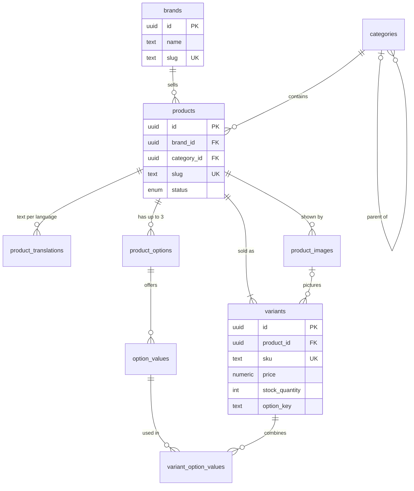
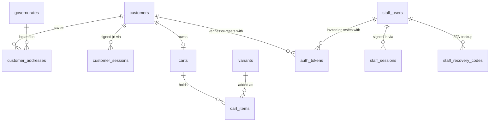
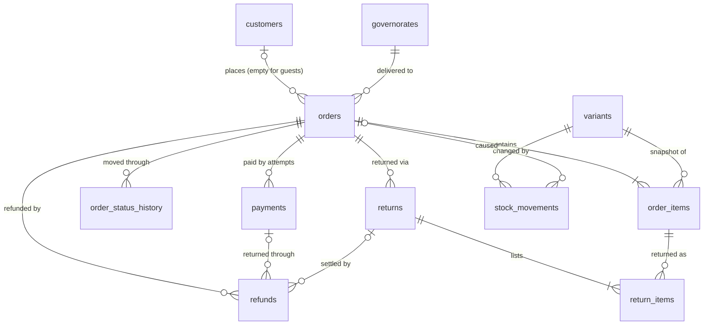
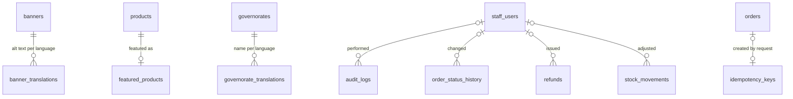

# Database Design — Beauty & Cosmetics E-commerce Platform

Oct 8, 2026 · @Fatma

## 1. Summary

The database has 41 tables in six domains: catalog, store configuration, customers and authentication, cart, orders and payments, and system records. It is PostgreSQL on Supabase, accessed only by the API through Prisma (D-068, D-083). The design is derived from the approved PRD; nothing is included that a requirement doesn't need.

This document was approved on 8 October 2026, including the modeling decisions in section 2 (D-108 to D-119) and the conventions below. It is the basis for the Prisma schema.

### Approved conventions

| ID | Convention |
| --- | --- |
| D-101 | UUID primary keys on every table; the customer-facing order number is a separate column from its own sequence |
| D-102 | `snake_case` plural table names in the database, `camelCase` in TypeScript, mapped by Prisma |
| D-103 | `created_at` and `updated_at` as `timestamptz` in UTC on every table; Cairo time only for display and reports |
| D-104 | Money as `numeric(12,2)`; a `currency` column (`EGP`) on every table holding prices or totals; never floating point |
| D-105 | Database enums for fixed lists (statuses, methods, roles, reasons) |
| D-106 | Deletion rule chosen per entity (archive, deactivate, anonymize, never delete, or hard delete); no general `deleted_at` column |
| D-107 | Foreign keys, unique constraints and check constraints enforce critical rules in the database itself |

### Reading the tables in this document

- **PK** primary key · **FK** foreign key · **UQ** unique · **CK** check constraint · **IX** index.
- **On delete** describes what happens to rows that reference a deleted row: **restrict** blocks the delete, **cascade** deletes them too, **set null** clears the reference.

## 2. Key modeling decisions (approved)

Twelve decisions shape the schema. Each solves a specific PRD requirement; the alternative and why it loses are given so you can judge the trade-off.

| ID | Decision | Solves | Alternative and why not |
| --- | --- | --- | --- |
| D-108 | Customer-facing text lives in separate `*_translations` tables keyed by record and language (`en`, later `ar`). Release 1.0 stores only English rows. Brand names are proper nouns and aren't translated | D-004: Arabic later without restructuring | JSON columns like `{"en": ..., "ar": ...}`: harder to search, index and keep unique per language |
| D-109 | Product options are a fixed list: Shade, Size, Scent, at most one of each per product. Their labels come from the translation files, and only Shade values can have a color swatch | D-009: up to 3 options; swatches | Free-text option names: every product could invent "Colour", "Color", "Shade", making filters and swatches unreliable. A new kind is one migration |
| D-110 | Each variant stores an `option_key` (its option value IDs in a fixed order), unique per product. A product without options has one default variant with an empty key | Two variants can never have the same combination | Checking only in code: a bug or race could create duplicates |
| D-111 | Stock is a number on each variant (check: never below 0), changed only by the inventory service, which also writes an append-only `stock_movements` row with the reason and the stock level afterwards | BE-05, AD-04: correct and explainable stock | Calculating stock by summing movements on every read: slower and harder to lock |
| D-112 | Customers and staff have separate account and session tables. Session tokens, reset tokens and invite tokens are stored only as hashes | D-042, D-073: separation, instant revocation | One shared users table with a type column: one bug could let a customer session reach staff data |
| D-113 | The database stores carts only for signed-in customers; guest carts stay in the browser until sign-in | D-019 | Server carts for guests too: more rows, cleanup jobs, and no benefit for the PRD |
| D-114 | Orders copy the contact details, delivery address, governorate name and every item's product name, brand, options, SKU and unit price at the moment of purchase | A-002: later edits never change past orders | Referencing live product and address rows: an edited price would rewrite order history |
| D-115 | Each payment attempt is its own `payments` row (a retried card payment creates a second row); refunds and received webhook events have their own tables. Webhook events are unique per provider event ID | BE-06, BE-07: retries, duplicate webhooks, full history | One payment column on the order: retries and refunds would overwrite each other |
| D-116 | Guest order access uses a long random token; only its hash is stored on the order | ST-16: secure guest tracking | Order number plus email: guessable and leaks data |
| D-117 | Emails are written to an `email_outbox` table inside the same transaction as the change that triggers them, sent right after commit, and retried by the daily sweep if sending failed | BE-11: an email failure never loses or blocks an order, and no email is sent for a rolled-back order | Sending directly: an email could go out for an order whose transaction then failed, or be lost if the email service is down |
| D-118 | Store settings are one row in a `store_settings` table (enforced by a check); governorates are a table of 27 seeded rows with their fee and enabled flag | AD-07, AD-13 | Settings as many key-value rows: no types, no defaults, easy to misspell |
| D-119 | The audit log is append-only, enforced by a database trigger that rejects updates and deletes. Idempotency keys are stored with the original response for 24 hours | D-044, BE-06 | Relying on application code alone for append-only: one careless query could alter history |

## 3. Entity-relationship diagrams

Four diagrams, one per area, keep each readable. Read a line like `brands ||--o{ products` as "one brand has zero or more products"; `|o` means the link is optional.

### 3.1 Catalog

Categories, option values and product images have translation tables of the same shape as `product_translations`; they're left out of the diagram for readability.

### 3.2 Customers, staff and carts

### 3.3 Orders, payments and stock

### 3.4 Store configuration and system records

Four tables stand alone with no foreign keys: `store_settings` (one row), `payment_webhook_events`, `email_outbox` and `rate_limit_counters`.

## 4. Table reference

Every table has `id` (UUID PK), `created_at` and `updated_at` unless noted; they're omitted below. Translation tables use the pair (record, `locale`) as their primary key and are deleted together with their record.

### 4.1 Catalog (13 tables)

| Table | Columns | Constraints and indexes | Deletion |
| --- | --- | --- | --- |
| `brands` | `name`, `slug`, `logo_storage_key`, `status` (ACTIVE, ARCHIVED) | UQ `name` (case-insensitive), UQ `slug` | Archive; hard delete blocked while products reference it |
| `brand_translations` | `brand_id`, `locale`, `description` | PK (`brand_id`, `locale`) | Cascade with brand |
| `categories` | `parent_id` (nullable, self), `slug`, `sort_order`, `status` | UQ `slug`; FK `parent_id` restrict. Two-level limit enforced by the service and tested | Archive; hard delete blocked while products or children exist |
| `category_translations` | `category_id`, `locale`, `name`, `description` | PK (`category_id`, `locale`) | Cascade |
| `products` | `brand_id`, `category_id`, `slug`, `status` (DRAFT, ACTIVE, ARCHIVED), `activated_at`, `version` | UQ `slug`; FK brand and category restrict; IX (`status`, `category_id`), IX (`status`, `brand_id`), IX `activated_at` | Archive; hard delete only for a draft never ordered or stocked (blocked by variant references) |
| `product_translations` | `product_id`, `locale`, `name`, `description` | PK (`product_id`, `locale`); trigram IX on `name` for partial search | Cascade |
| `product_options` | `product_id`, `kind` (SHADE, SIZE, SCENT), `position` | UQ (`product_id`, `kind`), UQ (`product_id`, `position`), CK `position` 1 to 3 | Cascade with product |
| `option_values` | `option_id`, `position`, `swatch_hex` | CK `swatch_hex` matches `#RRGGBB` | Cascade with option; blocked while a variant uses it (AD-02) |
| `option_value_translations` | `option_value_id`, `locale`, `label` | PK (`option_value_id`, `locale`) | Cascade |
| `variants` | `product_id`, `sku`, `option_key`, `price`, `currency`, `stock_quantity`, `is_enabled`, `status` (ACTIVE, ARCHIVED), `image_id`, `version` | UQ `sku`; UQ (`product_id`, `option_key`); CK `price > 0`; CK `stock_quantity >= 0`; FK `image_id` set null | Archive; hard delete blocked once it appears in an order or a stock movement |
| `variant_option_values` | `variant_id`, `option_value_id` | PK (both); FK `option_value_id` restrict | Cascade with variant |
| `product_images` | `product_id`, `storage_key`, `width`, `height`, `position` | IX (`product_id`, `position`); the first position is the main image | Hard delete (storage files removed too) |
| `product_image_translations` | `image_id`, `locale`, `alt_text` | PK (`image_id`, `locale`) | Cascade |

### 4.2 Store configuration (6 tables)

| Table | Columns | Constraints and indexes | Deletion |
| --- | --- | --- | --- |
| `banners` | `storage_key`, `link_url`, `position`, `starts_at`, `ends_at`, `is_active` | CK `ends_at > starts_at` when both set | Hard delete |
| `banner_translations` | `banner_id`, `locale`, `alt_text` | PK (`banner_id`, `locale`) | Cascade |
| `featured_products` | `product_id` (PK), `position` | FK product cascade | Hard delete |
| `governorates` | `code` (PK, e.g. `CAI`), `shipping_fee`, `currency`, `is_enabled`, `sort_order` | CK `shipping_fee >= 0` | Never deleted; disabled instead |
| `governorate_translations` | `code`, `locale`, `name` | PK (`code`, `locale`) | Never deleted |
| `store_settings` | `id` (always 1), `cod_max_order_value`, `free_shipping_threshold`, `return_window_days`, `low_stock_threshold`, `new_order_email_enabled`, `new_order_email_recipients`, `contact_email`, `contact_phone`, `version` | CK `id = 1`; CK amounts > 0 when set; CK `return_window_days` 1 to 365; CK `low_stock_threshold >= 0` | Never deleted |

### 4.3 Customers, staff and authentication (8 tables)

| Table | Columns | Constraints and indexes | Deletion |
| --- | --- | --- | --- |
| `customers` | `email`, `email_verified_at`, `password_hash`, `google_subject`, `first_name`, `last_name`, `phone`, `status` (ACTIVE, ANONYMIZED), `anonymized_at` | UQ `email` (case-insensitive, empty after anonymization); UQ `google_subject`; CK active customers have an email | Anonymized, never deleted (orders reference it) |
| `customer_addresses` | `customer_id`, `recipient_name`, `phone`, `governorate_code`, `city_area`, `street`, `building`, `floor`, `apartment`, `landmark`, `is_default` | Partial UQ: one default per customer; FK governorate restrict; max 10 per customer in the service | Hard delete; all deleted on anonymization |
| `customer_sessions` | `customer_id`, `token_hash`, `expires_at`, `last_seen_at`, `ip`, `user_agent` | UQ `token_hash`; IX `customer_id`; IX `expires_at` | Hard delete on sign-out, expiry, password change |
| `staff_users` | `email`, `password_hash`, `first_name`, `last_name`, `role` (ADMIN, STAFF), `status` (INVITED, ACTIVE, DEACTIVATED), `locale` (en, ar), `totp_secret_encrypted`, `totp_enabled_at`, `failed_login_count`, `locked_until`, `last_login_at` | UQ `email` (case-insensitive). Last-active-Admin rule enforced in the service inside a locked transaction | Deactivated, never deleted |
| `staff_sessions` | `staff_id`, `token_hash`, `expires_at` (12-hour cap), `last_seen_at` (30-minute idle), `two_factor_passed`, `ip`, `user_agent` | UQ `token_hash`; IX `staff_id` | Hard delete; all deleted on deactivation |
| `staff_recovery_codes` | `staff_id`, `code_hash`, `used_at` | IX `staff_id` | Replaced when 2FA is reset |
| `auth_tokens` | `purpose` (EMAIL\_VERIFICATION, PASSWORD\_RESET, EMAIL\_CHANGE, STAFF\_INVITE), `token_hash`, `customer_id`, `staff_id`, `new_email`, `expires_at`, `used_at` | UQ `token_hash`; CK exactly one of `customer_id`, `staff_id` | Hard delete after use or expiry (daily sweep) |
| `rate_limit_counters` | `key` (PK, e.g. `signin:email:...`), `count`, `window_ends_at` | none beyond PK | Hard delete after the window ends |

### 4.4 Cart (2 tables)

| Table | Columns | Constraints and indexes | Deletion |
| --- | --- | --- | --- |
| `carts` | `customer_id` | UQ `customer_id`; FK cascade | Deleted with the customer's data on anonymization |
| `cart_items` | `cart_id`, `variant_id`, `quantity` | PK (`cart_id`, `variant_id`); CK `quantity` 1 to 10 | Hard delete; cascade with cart or a deleted draft variant |

### 4.5 Orders, payments and stock (9 tables)

| Table | Columns | Constraints and indexes | Deletion |
| --- | --- | --- | --- |
| `orders` | `order_number`, `customer_id`, `guest_token_hash`, `status`, `payment_status`, `payment_method`, contact (`contact_name`, `contact_email`, `contact_phone`), address snapshot (`recipient_name`, `ship_phone`, `governorate_code`, `governorate_name`, `city_area`, `street`, `building`, `floor`, `apartment`, `landmark`), `note`, `currency`, `subtotal`, `shipping_fee`, `total`, `expires_at`, `courier_name`, `tracking_number`, `shipped_at`, `delivered_at`, `cancelled_at`, `cancellation_reason`, `version`, `anonymized_at` | UQ `order_number` (sequence from 100001); UQ `guest_token_hash`; CK `total = subtotal + shipping_fee`, all ≥ 0; CK `note` ≤ 500 characters; CK Shipped or Delivered requires `tracking_number`; IX (`status`, `created_at`), IX (`customer_id`, `created_at`); partial IX `expires_at` where Awaiting payment | Never deleted; personal fields anonymized |
| `order_items` | `order_id`, `variant_id`, `product_name`, `brand_name`, `option_summary`, `sku`, `unit_price`, `quantity`, `line_total` | CK `quantity > 0`; CK `line_total = unit_price × quantity`; FKs restrict | Never deleted |
| `order_status_history` | `order_id`, `from_status`, `to_status`, `actor_type` (CUSTOMER, STAFF, SYSTEM, PAYMENT\_WEBHOOK), `staff_id`, `note` | IX (`order_id`, `created_at`) | Never deleted |
| `payments` | `order_id`, `method` (CARD, COD, WALLET), `provider` (PAYMOB, empty for COD), `provider_reference`, `amount`, `currency`, `status` (PENDING, SUCCEEDED, FAILED, CANCELLED), `succeeded_at`, `collected_by_staff_id`, `failure_reason` | UQ (`provider`, `provider_reference`); CK `amount > 0`; CK COD rows have no provider; IX `order_id` | Never deleted |
| `refunds` | `order_id`, `payment_id`, `return_id`, `amount`, `currency`, `method` (PROVIDER, BANK\_TRANSFER, WALLET\_TRANSFER, CASH), `status` (PENDING, SUCCEEDED, FAILED), `provider_reference`, `idempotency_key`, `reason`, `staff_id`, `completed_at` | UQ `idempotency_key`; CK `amount > 0`; total refunds ≤ amount paid enforced in the service under an order row lock | Never deleted |
| `returns` | `order_id`, `staff_id`, `note`, `override_reason` | IX `order_id` | Never deleted |
| `return_items` | `return_id`, `order_item_id`, `quantity`, `disposition` (RESTOCK, WRITE\_OFF) | CK `quantity > 0`; returned total ≤ ordered quantity enforced in the service | Never deleted |
| `payment_webhook_events` | `provider`, `event_id`, `event_type`, `payload`, `signature_valid`, `received_at`, `processed_at`, `error` | UQ (`provider`, `event_id`) | Kept 90 days, then deleted (proposed) |
| `stock_movements` | `variant_id`, `quantity_change`, `stock_after`, `reason` (ORDER\_PLACED, ORDER\_CANCELLED, ORDER\_EXPIRED, RETURNED\_TO\_SENDER, RETURN\_RESTOCKED, RECEIVED, CORRECTION, DAMAGED), `order_id`, `return_id`, `staff_id`, `note` | CK `quantity_change <> 0`; CK `stock_after >= 0`; IX (`variant_id`, `created_at`) | Never deleted |

### 4.6 System records (3 tables)

| Table | Columns | Constraints and indexes | Deletion |
| --- | --- | --- | --- |
| `idempotency_keys` | `scope` (e.g. `place_order`), `key`, `request_hash`, `response_status`, `response_body`, `order_id`, `expires_at` | UQ (`scope`, `key`); same key with a different request body is rejected | Hard delete after 24 hours |
| `audit_logs` | `staff_id`, `action` (e.g. `product.price_changed`), `entity_type`, `entity_id`, `before`, `after`, `ip` | Trigger rejects UPDATE and DELETE; IX (`entity_type`, `entity_id`), IX (`staff_id`, `created_at`), IX `created_at` | Never deleted |
| `email_outbox` | `template`, `to_email`, `locale`, `payload`, `status` (PENDING, SENT, FAILED), `attempts`, `next_attempt_at`, `sent_at`, `last_error` | IX (`status`, `next_attempt_at`) | Sent rows deleted after 30 days, since they contain personal data (proposed) |

## 5. Transactions and concurrency

Four techniques prevent the race conditions in the PRD. All use PostgreSQL's default isolation level (read committed) with explicit row locks, which is enough at this scale and simpler to reason about than stricter levels.

| Technique | What it does | Used for |
| --- | --- | --- |
| Row lock (`SELECT ... FOR UPDATE`) | Other transactions wanting the same rows wait until this one finishes | Stock during order placement and adjustments; an order's row during refunds; Admin rows when changing roles |
| Compare-and-set update | `UPDATE ... WHERE id = ? AND status = 'expected'`; zero rows changed means someone else got there first | Every order status change; webhook vs. expiry vs. customer cancel |
| Version number (optimistic locking) | `UPDATE ... WHERE id = ? AND version = ?` and increment `version`; zero rows means the record changed since it was loaded | Admin edits to products, orders and settings ("changed by someone else, reload") |
| Unique constraint as a gate | Inserting a duplicate key fails, so only the first attempt proceeds | Idempotency keys, webhook event IDs, refund idempotency keys |

### 5.1 Placing an order

External calls (the payment provider) never happen inside a database transaction, because a slow network call would hold locks and block other shoppers.

1. **Idempotency gate.** Insert the request's idempotency key. If it already exists with the same request, return the stored response; with a different request, reject it (422).
2. **Release expired orders** for the requested variants, each in its own short transaction after asking the provider whether it was paid (D-080, D-084).
3. **Begin transaction.**
4. **Lock the variant rows** with `FOR UPDATE`, always in order of variant ID. Locking in a fixed order prevents two transactions from each waiting for the other (a deadlock).
5. **Check** each variant: product active, variant enabled, enough stock. Re-read current prices; never use prices sent by the browser (R-002).
6. **Calculate** subtotal, shipping fee (governorate fee, or 0 above the free-shipping threshold) and total; check the COD limit for COD orders.
7. **Write** the order with its snapshots, order items, the first status-history row, stock deductions with their stock movements, and the confirmation email in the outbox.
8. **Commit.** If any step fails, nothing is saved and the stock is untouched.
9. **After commit**, for card orders: create the payment session with the provider, save a pending payment row, and return the redirect URL. If the provider is unreachable, the order stays Awaiting payment and the customer sees "retry payment" (ST-15).

**Why this can't oversell:** if 20 shoppers try to buy the last 5 units at once, step 4 makes them queue one at a time. Each sees the stock left by the previous one, and the database check `stock_quantity >= 0` refuses anything a bug might let through (SM-3).

### 5.2 Order status changes

All changes go through one function in the orders service that knows the allowed transitions (FL-07). It runs a compare-and-set update, writes the status-history row and any audit entry, and queues emails, all in one transaction. When a webhook, the expiry job and a customer's cancel arrive together, exactly one wins; the others get "order has already moved on" (409).

### 5.3 Payment webhooks

1. Verify the signature; reject and log if invalid.
2. Insert the event into `payment_webhook_events`. A duplicate event ID fails the insert, so the event is acknowledged (200) and ignored.
3. In a transaction: update the payment row, compare-and-set the order from Awaiting payment to Confirmed, and set the payment status. If the order already expired, follow the late-payment rule (BE-07).
4. Mark the event processed. Any error is stored on the event for investigation, and the provider's retry will be safe.

### 5.4 Refunds

1. Lock the order row.
2. Sum successful and pending refunds; reject if the new amount would exceed the amount paid.
3. Insert the refund as pending with an idempotency key; commit.
4. Call the provider outside the transaction, using the same idempotency key. The refund becomes successful when the provider's webhook confirms it; payment status then updates to Partially refunded or Refunded.

### 5.5 Other locked operations

- **Stock adjustments** lock the variant row, exactly like order placement.
- **Last-Admin protection** locks all active Admin rows before counting them, so two Admins can't demote each other at the same moment.

## 6. Search and performance indexes

At 500 products and about 100 orders a day, PostgreSQL alone meets the PRD's performance targets; no search service or cache is needed (D-058). Indexes are added only for queries the PRD actually runs.

### Search (ST-04)

Partial matching ("lip" finds "Lipstick") uses PostgreSQL's trigram extension `pg_trgm`, which Supabase supports. A trigram index lets `ILIKE '%lip%'` use an index instead of scanning every row.

| Searched | Index |
| --- | --- |
| Product names | Trigram index on `product_translations.name` |
| Brand names | Trigram index on `brands.name` |
| Category names | Trigram index on `category_translations.name` |
| Staff search by SKU | Unique index on `variants.sku` |
| Staff search by order number, email, phone | UQ `order_number`; indexes on `contact_email` and `contact_phone` |

Typo tolerance stays out of scope (section F of the PRD); the same extension could add it later with similarity matching.

### Listings and dashboard queries

| Query | Supported by |
| --- | --- |
| Category and brand pages, filtered by status | IX (`status`, `category_id`), IX (`status`, `brand_id`) on products |
| New arrivals | IX `activated_at` on products |
| "From" price, price filter and price sort | Computed from each product's lowest enabled variant price; at 500 products this is a fast aggregate. If it becomes slow, a stored `min_price` column on products is the planned fix |
| In-stock filter | Computed from variants with `stock_quantity > 0` |
| Best-selling (last 30 days) | `order_items` joined to orders by `created_at`; small enough to compute on request |
| Staff order list | IX (`status`, `created_at`) on orders |
| Customer order history | IX (`customer_id`, `created_at`) on orders |
| Revenue in a period | IX on `payments.succeeded_at` and `refunds.completed_at` |
| Low-stock list | Small table scan of variants; an index adds nothing at 5,000 rows |
| Expired unpaid orders | Partial IX on `orders.expires_at` where status is Awaiting payment |

Case-insensitive uniqueness for emails and brand names uses the `citext` extension, so `Nour@Mail.com` and `nour@mail.com` count as the same address.

## 7. Migrations, seed data and retention

Schema changes go only through versioned Prisma migrations (BE-16). Some rules in this document can't be expressed in Prisma's schema language, so they are written as SQL inside the migration files.

### Migrations

| Rule | Detail |
| --- | --- |
| Tool | `prisma migrate dev` creates migrations locally; `prisma migrate deploy` applies them in CI using the direct connection (D-083) |
| Never edit an applied migration | Fixes are new migrations, so every environment ends up identical |
| Expand, then contract | Add new columns or tables first, switch the code, remove the old parts in a later migration; old and new code both work during a deploy |
| Written as SQL in migrations | Check constraints, partial unique indexes, trigram indexes, the `pg_trgm` and `citext` extensions, the order-number sequence starting at 100001, the audit-log append-only trigger |
| Supabase lockdown (D-088) | A migration enables Row Level Security on every table with no access rules; a CI test fails if any table lacks it |
| Review | Every migration is read before merging: SQL generated by a tool can drop data |

### Seed data

| Data | Development | Demo |
| --- | --- | --- |
| 27 governorates with English names and placeholder fees | Yes | Yes |
| Store settings row with PRD defaults (14-day returns, low-stock threshold 5) | Yes | Yes |
| Demo catalog: brands, two-level categories, products with shades, sizes and scents | Yes | Yes |
| One Admin and one Staff account with known test passwords | Yes | No; the first Admin comes from the setup script with credentials from environment variables (D-042) |
| Sample customers and orders across every status | Yes | A few, for screenshots |

Seed scripts are idempotent: running them twice doesn't create duplicates.

### Retention (A-005, BE-15)

| Data | Kept for |
| --- | --- |
| Orders, items, payments, refunds, returns, stock movements, status history, audit log | Indefinitely (personal fields anonymized on account deletion) |
| Payment webhook events | 90 days (proposed) |
| Sent emails in the outbox | 30 days (proposed) |
| Sessions, one-time tokens, rate-limit counters, idempotency keys | Until expiry; removed by the daily sweep |
| Application logs (outside the database) | 30 days |

### Account deletion (ST-11)

In one transaction: the customer's name, email, phone and Google link are cleared and the status becomes Anonymized; addresses, sessions, tokens and cart are deleted; each of their orders has its contact and address fields replaced with "Deleted customer" and its `anonymized_at` set. Order amounts, items and history stay, so reports and stock history remain correct.

### To approve

- [x] D-108 to D-119: the modeling decisions in section 2
- [x] Retention of webhook events (90 days) and sent emails (30 days)
- [x] This document as the basis for the Prisma schema
