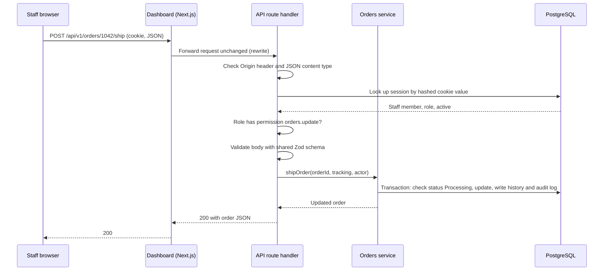
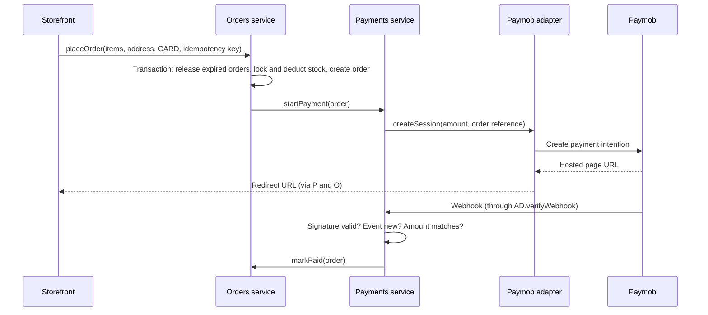
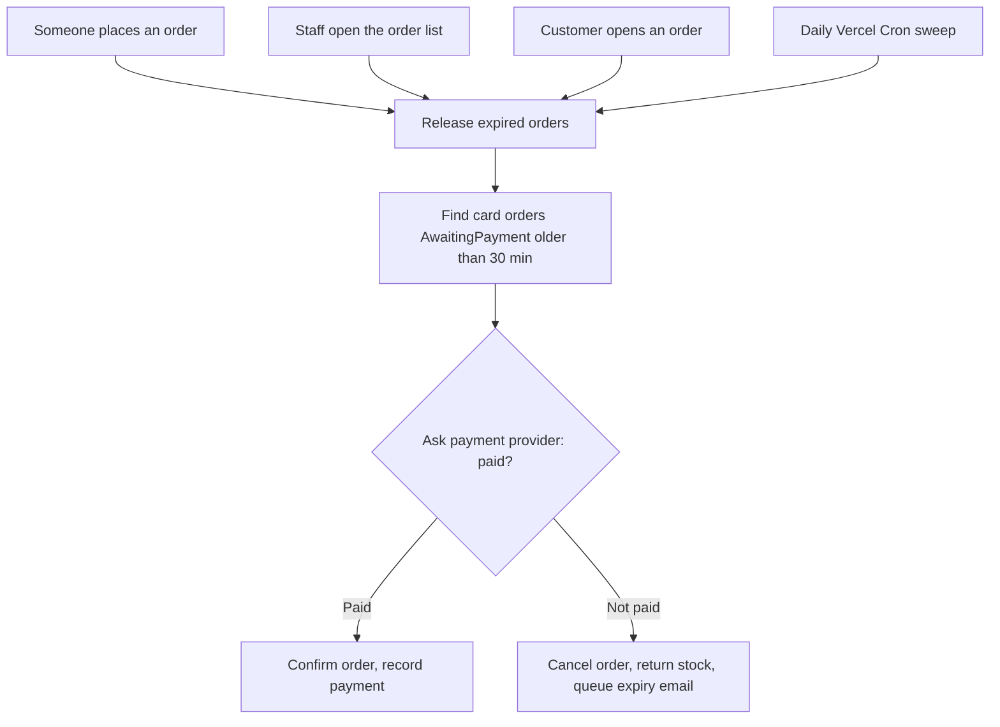

# Architecture — Beauty & Cosmetics E-commerce Platform

Oct 8, 2026 · @Fatma

## 1. Summary

The platform is three Next.js apps in one TypeScript monorepo: a customer storefront, an admin dashboard, and an API app that holds all business logic. The API is the only component that touches the database, the file storage and the external services. It runs as a modular monolith on Vercel, with PostgreSQL and image storage on Supabase, Paymob for card payments, Resend for email and Sentry for error tracking, all on free plans (D-065 to D-088 in the PRD).

This document describes how the parts fit together. It was approved on 8 October 2026, including the tooling choices in section 9. The database schema and the API endpoint contracts are designed in phase 3.

### Architecture principles

1. **One owner of data and rules.** Only the API app reads or writes the database. Frontends never connect to Supabase directly (D-088).
2. **The server decides.** Prices, totals, stock, permissions and payment status are always computed or verified on the server (R-001 to R-003).
3. **Thin edges, plain core.** Route handlers only translate HTTP. Business logic lives in framework-independent services that can be tested without Next.js (D-071).
4. **Every external service sits behind an interface.** Payments, email, file storage and error reporting each have a small interface with one adapter per provider, so a client can switch providers by writing one adapter (D-077, D-085, D-086).
5. **One contract, written once.** Shared Zod schemas define every request and response; the API validates with them, the frontends use their types, and the OpenAPI documentation is generated from them (D-069).
6. **Free now, paid later by configuration.** Nothing in the code depends on a free-tier workaround except settings, such as the order-expiry schedule (D-084).

## 2. System overview

Browsers reach only their own frontend; the API is the single gateway to data and external services.

&#91;embedded content: system overview · 3 apps, 1 API, 5 external services\]

The one exception is payment: the shopper's browser is redirected to Paymob's hosted page, so card details never pass through our apps (D-079). All three apps also report errors to Sentry; only the API's link is drawn.

## 3. Components and responsibilities

Each component has one job. Anything not listed for a component is not its responsibility, which keeps bugs and security checks in one place.

| Component | Responsible for | Not responsible for | Talks to |
| --- | --- | --- | --- |
| Storefront (`apps/storefront`) | Customer pages rendered on the server for SEO and speed; cart UI; checkout form; redirect to the payment page; proxying `/api/*` to the API (D-072) | Prices, stock checks, payment status, permissions | API app only |
| Dashboard (`apps/dashboard`) | Staff screens in English and Arabic (RTL); forms and tables; hiding actions a role can't use (convenience only); proxying `/api/*` | Enforcing permissions, calculating revenue or stock | API app only |
| API app (`apps/api`) | Authentication and sessions; permission checks; validation; all business rules; database transactions; calling external services; receiving webhooks; scheduled jobs | Rendering pages | Database, storage, Paymob, Resend, Sentry |
| Shared package (`packages/shared`) | Zod schemas for every request and response; shared types; constants such as order statuses, permission names and governorate codes | Any runtime logic that needs a server or database | Imported by all three apps |
| Supabase PostgreSQL | Durable data with foreign keys, unique constraints and row locks | Business rules (they live in the API) | API app only (D-088) |
| Supabase Storage | Product and banner images in fixed WebP sizes; public read access | Deciding who may upload | API app writes; browsers read public image URLs |
| Paymob | Hosted card (and later wallet) payment page; signed webhooks; refunds; status lookups | Order logic | API app through the `PaymentProvider` adapter; shoppers' browsers on its hosted page |
| Resend | Delivering transactional emails | Deciding when to send | API app through the `EmailSender` adapter |
| Sentry | Collecting unhandled errors from all three apps | Business logging | All three apps |
| Vercel Cron | Calling the protected daily job endpoint | Running the job logic | API app |

## 4. Code structure

One repository holds three apps and one shared package (D-067). Inside the API, code is grouped by business module, and each module has the same three layers.

### Monorepo layout

```
beauty-store/
├── apps/
│   ├── storefront/          Next.js: customer pages
│   ├── dashboard/           Next.js: staff pages, English/Arabic
│   └── api/                 Next.js: Route Handlers only
│       ├── app/api/v1/...   thin route handlers (HTTP in, HTTP out)
│       ├── src/modules/     business modules (below)
│       ├── src/platform/    db client, auth, errors, logging, adapters
│       └── prisma/          schema.prisma, migrations, seed
├── packages/
│   └── shared/              Zod schemas, types, constants
├── supabase/                local Supabase CLI configuration
└── docs/                    architecture notes, OpenAPI output, runbooks
```

### API modules

| Module | Owns |
| --- | --- |
| `auth` | Customer and staff sign-in, sessions, password reset, email verification, invites, 2FA |
| `customers` | Profiles, addresses, account deletion and anonymization |
| `staff` | Staff accounts, roles, permission mapping |
| `catalog` | Products, options, variants, brands, categories, images, search |
| `inventory` | Stock levels, adjustments, stock movements, low-stock queries |
| `cart` | Server carts, guest cart merge, re-pricing |
| `orders` | Order placement transaction, snapshots, status lifecycle, cancellation, expiry, returns |
| `payments` | Payment sessions, webhooks, reconciliation, refunds, COD collection |
| `shipping` | Governorates, fees, free-shipping threshold |
| `content` | Homepage banners and featured products |
| `settings` | Store settings such as COD limit, return window, low-stock threshold |
| `analytics` | Dashboard metrics and CSV exports |
| `audit` | Writing and reading the audit log |
| `notifications` | Deciding which email to send and building it |
| `jobs` | The daily sweep and any future scheduled tasks |

### Layers inside each module

| Layer | File example | Does | Never does |
| --- | --- | --- | --- |
| Route handler | `app/api/v1/orders/route.ts` | Reads the request, resolves the session, checks the permission, validates with Zod, calls a service, maps the result or error to HTTP | Business rules, database queries |
| Service | `modules/orders/order.service.ts` | Business rules and transactions, e.g. `placeOrder`, `cancelOrder` | Read HTTP requests or cookies |
| Repository | `modules/orders/order.repository.ts` | Prisma queries, including the raw `SELECT ... FOR UPDATE` row lock for stock | Decide business outcomes |

### Dependency rules

- Route handlers call services; services call repositories and adapters. Never the other way around.
- A module uses another module only through its service, never its repository. For example, `orders` asks `inventory.service` to reserve stock rather than writing stock rows itself.
- External services are reached only through interfaces in `src/platform/adapters`: `PaymentProvider`, `EmailSender`, `FileStorage`, `ErrorReporter`.
- `packages/shared` imports nothing from the apps.

## 5. Key runtime flows

Three flows show how the parts cooperate. The full user journeys are in PRD section D.

### 5.1 An authenticated staff request

The browser only ever talks to the dashboard's own address, so the session cookie is first-party (D-072). Every check happens in the API.



If any check fails, the API returns the shared error format: 401 for no valid session, 403 for a missing permission, 404 for a record the user may not see, 409 for an invalid status change, and 422 for validation errors.

### 5.2 Checkout with a card payment

The orders module doesn't know which payment provider is in use; it only talks to the `PaymentProvider` interface (D-077).



Swapping Paymob for Kashier means writing a new adapter with the same four methods (create session, verify webhook, refund, get status); nothing else changes.

### 5.3 On-demand order expiry

On free hosting, expired unpaid card orders are released at the moment they matter, plus once a day (D-084).



The release step locks each order row before changing it, so a webhook arriving at the same moment can't produce a double update. On paid hosting, a cron job every few minutes calls the same release function.

## 6. Cross-cutting concerns

These apply to every module and are built once, in the backend foundation phase, before any feature module.

| Concern | Approach | Decisions |
| --- | --- | --- |
| Sessions | Random session ID in an HttpOnly, Secure, SameSite=Lax cookie; only its hash stored in the database; new ID at every login; customer sessions 30 days renewed while active, staff per AD-01 | D-073, D-075 |
| Customer vs staff separation | Separate account tables and session types; cookies separated by frontend address | D-042, D-072 |
| Authentication code | Own layer using vetted libraries for password hashing (Argon2id), Google OAuth and TOTP | D-074 |
| Authorization | Every admin route declares a named permission; roles map to permission lists in one file; customer routes check record ownership and return 404 for others' records | D-041, BE-03 |
| Forged requests (CSRF) | SameSite=Lax cookies, JSON-only mutations, Origin header check | D-076 |
| Validation | Shared Zod schemas validate every body, query and path parameter; unknown fields rejected | D-069, BE-04 |
| Errors | One error format (`code`, `message`, field `details`, `requestId`); service errors are typed (e.g. `OutOfStockError`) and mapped to HTTP status in one place | BE-01, BE-04 |
| Money | PostgreSQL `numeric(12,2)` in EGP; never JavaScript floating-point arithmetic for money; sent as strings with 2 decimals | BE-01, NFR-09 |
| Concurrency | Stock rows locked inside the order transaction; status changes check the current status in the same transaction; optimistic version numbers for admin edits | BE-05, AD-02 |
| Idempotency | Client-generated key on "place order"; webhook event IDs stored; idempotency keys on refunds | BE-06 |
| Rate limiting | Counters stored in PostgreSQL (shared across serverless instances) for sign-in, password reset and place-order | NFR-14 |
| Time | Stored in UTC; displayed and grouped in Africa/Cairo | D-045 |
| Dashboard languages | All interface text from translation files; `lang` and `dir` set from the staff member's saved language; logical CSS classes only | D-003, D-004, AD-15 |
| Logging | Structured JSON logs with a request ID; no passwords, tokens or full cookies in logs | BE-14 |
| Error tracking | Sentry in all three apps, with personal data scrubbed before sending | D-087 |
| Audit | Sensitive admin actions recorded by the service that performs them, inside the same transaction | D-044, BE-13 |
| Supabase lockdown | Public Data API off or restricted; Row Level Security on every table with no access rules; secret keys only in the API app | D-088 |

## 7. Environments, configuration and deployment

There are two environments: your machine and one deployed demo (D-061). Code only reaches the demo after automated checks pass.

### Environments

|  | Local development | Deployed demo |
| --- | --- | --- |
| Apps | All three via one command from the monorepo root | Three Vercel Hobby projects from the same repository (D-082) |
| Database | Supabase CLI local stack in Docker | Supabase Free project, Stockholm `eu-north-1` (D-083, D-153) |
| Images | Supabase CLI local storage | Supabase Storage bucket (D-086) |
| Payments | Paymob test keys; a tunnel tool forwards test webhooks to your machine | Paymob test keys (D-005) |
| Email | Mailpit catches every email locally | Resend; delivers only to your own address until a domain is verified (D-085) |
| Errors | Printed to the console | Sentry (D-087) |
| Data | Seed script: governorates, demo catalog, one Admin, one Staff | Same seed, run once |

### Configuration

All secrets come from environment variables; the repository contains only `.env.example` files listing the names. Variables starting with `NEXT_PUBLIC_` reach the browser, so no secret ever uses that prefix.

| App | Variables (names only) |
| --- | --- |
| API | `DATABASE_URL` (pooled), `DIRECT_URL` (migrations), `SUPABASE_URL`, `SUPABASE_SERVICE_KEY`, `PAYMOB_SECRET_KEY`, `PAYMOB_PUBLIC_KEY`, `PAYMOB_HMAC_SECRET`, `PAYMOB_CARD_INTEGRATION_ID`, `RESEND_API_KEY`, `EMAIL_FROM`, `GOOGLE_CLIENT_ID`, `GOOGLE_CLIENT_SECRET`, `CRON_SECRET`, `STOREFRONT_URL`, `DASHBOARD_URL`, `SENTRY_DSN` |
| Storefront | `API_INTERNAL_URL` (rewrite target), `NEXT_PUBLIC_SITE_URL`, `NEXT_PUBLIC_IMAGE_BASE_URL`, `SENTRY_DSN` |
| Dashboard | `API_INTERNAL_URL`, `SENTRY_DSN` |

The API checks all its variables at startup with a Zod schema and refuses to start if one is missing, so a misconfigured deployment fails immediately instead of at the first payment.

### Deployment pipeline

1. Every push and pull request runs CI (GitHub Actions): install, lint, type-check, unit and integration tests against a temporary PostgreSQL, and a production build of all three apps.
2. Merging to `main` runs database migrations against the demo database (`prisma migrate deploy` using `DIRECT_URL`), then Vercel deploys the three apps. Built in phase 5; until then migrations are applied by hand (D-152).
3. Migrations must be backward-compatible with the previous app version (add first, remove later), because the old code runs briefly against the new schema.
4. Rollback: redeploy the previous Vercel deployment; schema changes are rolled forward with a new migration, never by editing an applied one.
5. Branch preview deployments are turned off for the API so nothing but `main` can write to the single demo database.

### Scheduled job

Vercel Cron calls `/api/v1/jobs/daily` once a day, sending `CRON_SECRET` in the `Authorization` header; the endpoint rejects any other caller. On the free plan the call can arrive any time within the scheduled hour. The job is safe to run twice and safe to miss (BE-12).

## 8. Free-tier limits and risks

The free plans comfortably cover a portfolio demo. The table lists every limit that could affect it and what the design does about it.

| Risk | Limit | Impact | Mitigation |
| --- | --- | --- | --- |
| Database pauses | Supabase Free pauses after 7 days without activity | Demo offline until resumed in the Supabase dashboard | Daily cron touches the database; confirm after the first week; a monthly calendar check |
| No automatic backups | Daily backups are a Pro feature | Data loss if the demo database is damaged | Own backup and restore procedure, run once and documented (D-062); seed script can rebuild demo data |
| Image storage | 1 GB on Supabase Free | Uploads fail when full | Fixed WebP sizes; modest demo image count; storage usage shown in the runbook |
| Upload size | Vercel functions accept at most 4.5 MB per request | Large photos rejected | Browser-side resize; 4 MB limit (D-086) |
| Cron frequency | Vercel Hobby cron runs at most once a day | No minute-level jobs | On-demand order expiry (D-084) |
| Email reach | Resend without a verified domain only delivers to your own address | Testers don't receive emails | Explain on the demo's About page; emails visible in Resend's log |
| Commercial use | Vercel Hobby is personal and non-commercial only | Can't host a client store | Client projects move to a paid plan (section 10) |
| Cold starts | Serverless functions start slowly after idle time | First request after a pause is slower | Accepted for the demo (D-058); performance targets measured on paid-equivalent settings |
| Connection limits | Serverless functions open many short connections | Database connection errors under load | Pooled connection string for the app (D-083) |
| Function region | Functions far from the database add latency to every query | Slow API | Deploy all three apps' functions in the same European region as the database (D-153, D-154) |

## 9. Tooling choices (approved)

These smaller choices complete the architecture. Each is a widely used default for this stack; none changes the PRD. All were approved on 8 October 2026.

| ID | Area | Recommendation | Why |
| --- | --- | --- | --- |
| D-089 | Monorepo tooling | pnpm workspaces + Turborepo | pnpm links the shared package into all apps; Turborepo runs lint, test and build across apps and skips work that hasn't changed |
| D-090 | Framework version | Latest stable Next.js and React at setup, TypeScript strict mode in every package | One version across all three apps avoids subtle differences |
| D-091 | Styling and components | Tailwind CSS with logical (RTL-safe) classes; shadcn/ui components built on accessible Radix primitives | Components are copied into the project, so they're fully editable; accessibility comes built in |
| D-092 | Dashboard translations | next-intl, with the language taken from the staff member's saved preference | Designed for the Next.js App Router; handles messages, plurals, dates and numbers |
| D-093 | Dashboard data fetching and forms | TanStack Query for server data; React Hook Form with the shared Zod schemas | Caching, loading and error states handled consistently; the same validation rules as the API |
| D-094 | Storefront rendering | Server components with caching for catalog pages; client components only for cart and checkout interactions | Fast first load and good SEO (NFR-03, NFR-23) |
| D-095 | Image processing | sharp in the API to validate, resize and convert uploads to WebP | Standard, fast library for server-side image work |
| D-096 | Logging | Pino for structured JSON logs | Lightweight and fast; easy to add the request ID to every line |
| D-097 | Testing tools | Vitest for unit and integration tests; Playwright for end-to-end and accessibility checks (with axe) | Details come in the testing strategy; named now so the repository is set up for them |
| D-098 | CI | GitHub Actions running lint, type-check, tests and build on every push | Free for public repositories; blocks broken builds from reaching the demo |
| D-099 | Code quality | ESLint and Prettier; one shared config package | Consistent style across the monorepo |

## 10. Adapting the platform for a real client

Moving from the demo to a client's live store is mostly configuration and accounts, not code. The code changes are limited to branding and, if the client prefers other providers, new adapters.

| Area | Demo | Client store |
| --- | --- | --- |
| Hosting | Vercel Hobby (non-commercial) | Vercel Pro or another host that runs Next.js |
| Database and storage | Supabase Free | Supabase Pro: daily backups, no pausing; restore tested before launch |
| Payments | Paymob test keys | Client's own verified Paymob merchant account and live keys; one live test payment and refund |
| Domain and email | Platform addresses; Resend sends only to the developer | Client domain for the storefront and dashboard; domain verified in Resend |
| Scheduled jobs | Daily cron + on-demand expiry | Expiry job every few minutes |
| Search engines | Demo marked noindex (NFR-25) | Indexing allowed; sitemap submitted |
| Legal | Placeholder policy pages | Client's privacy, returns and terms reviewed by a lawyer; e-invoicing if the client is registered |
| Monitoring | Sentry free, one user | Plan sized to the client; uptime monitor and alerts |
| Branding | Demo store name, colors, logo | Client theme values and assets |

### Go-live checklist (summary)

- [ ] All environment variables set with live values; no test keys in production
- [ ] Database migrations applied; seed data replaced with the client's catalog
- [ ] First Admin created with the setup script; 2FA enabled
- [ ] One live card payment and refund completed successfully
- [ ] Backup restore tested on the production plan
- [ ] Security checklist and performance targets verified on production settings
