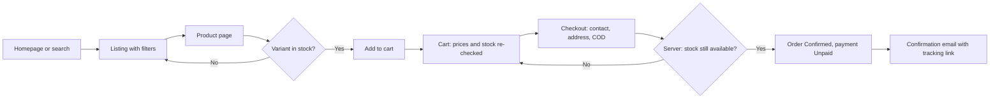
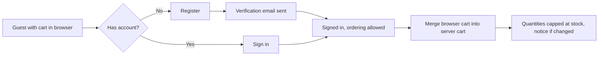
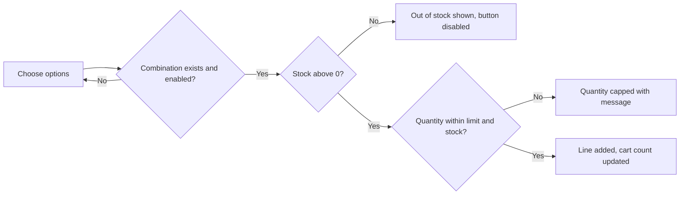
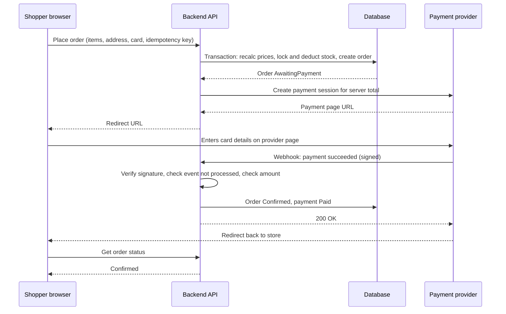
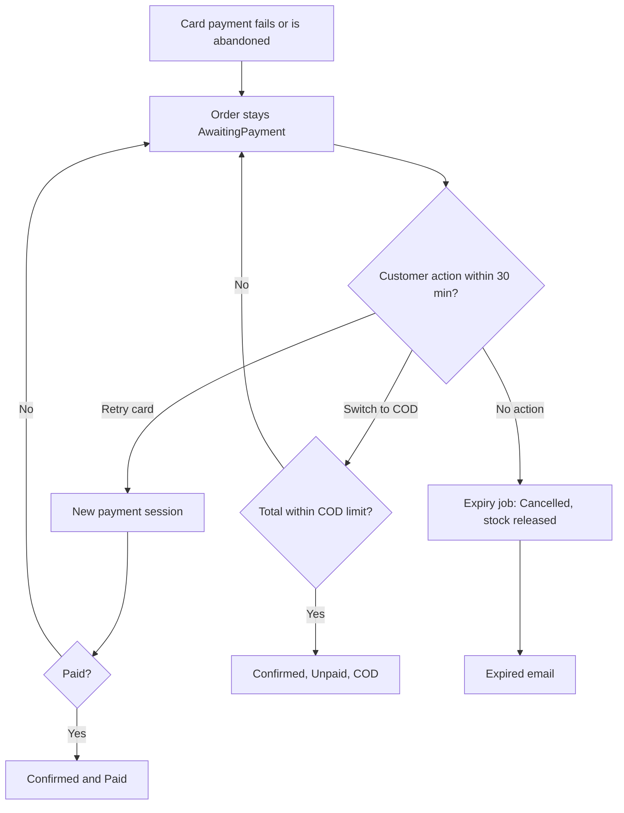
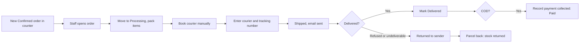
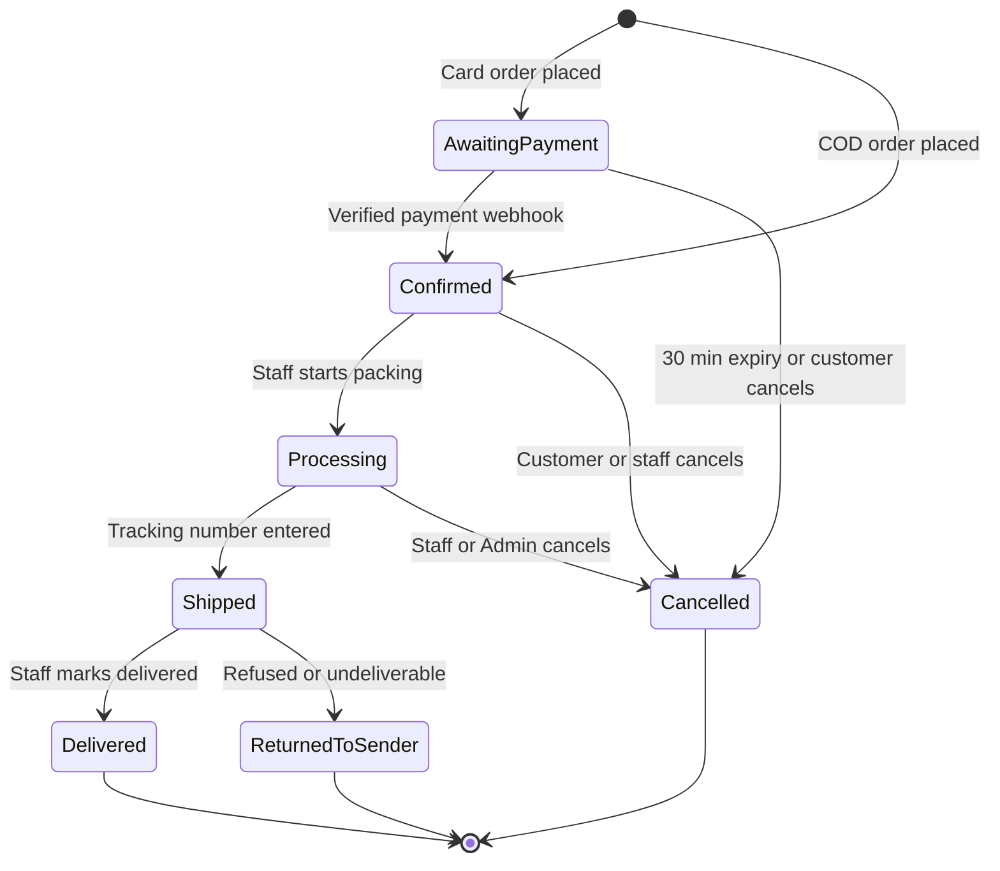
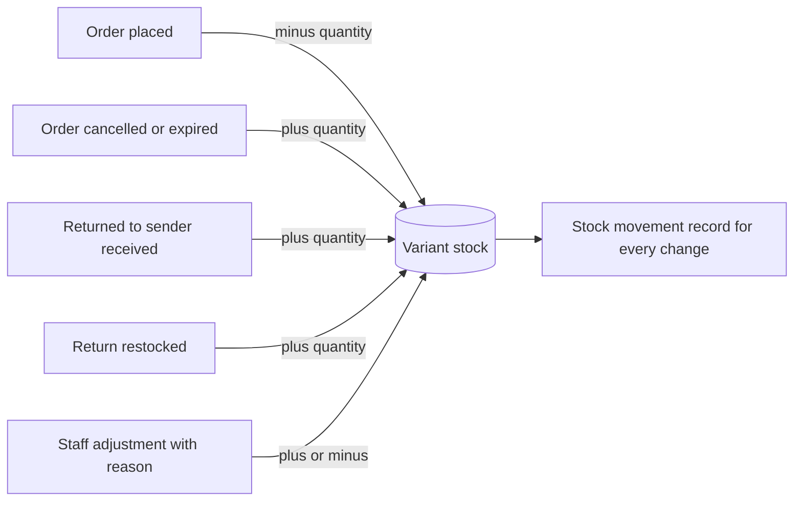
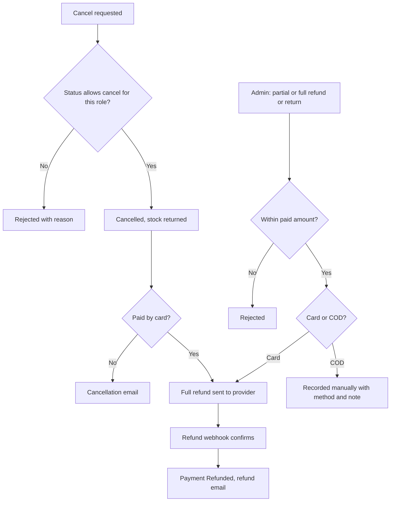
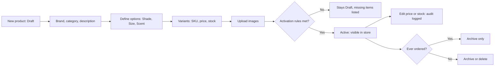

# PRD — Beauty & Cosmetics E-commerce Platform

Oct 8, 2026 · @Fatma

## 0. About this document

This PRD defines release 1.0 of a single-seller beauty and cosmetics store for Egypt: a customer storefront, an admin dashboard, and one backend API. It is version 1.0, approved on 8 October 2026, and it is built only from decisions confirmed during discovery (D-001 to D-062) and assumptions A-001 to A-006.

It is a practice and portfolio project. Everything is built to production standards, but it runs on free hosting with sandbox payments. Sections F and G list what a real client would add.

### How to read this document

| Label | Meaning |
| --- | --- |
| ST-xx | Storefront functional requirement |
| AD-xx | Admin dashboard functional requirement |
| BE-xx | Backend functional requirement |
| FL-xx | User flow |
| NFR-xx | Non-functional requirement |
| D-xxx | Confirmed decision from the decision log |
| A-xxx | Assumption approved during discovery |
| R-xxx | Non-negotiable rule |

Priorities use MoSCoW for release 1.0:

- **Must Have:** release 1.0 cannot ship without it.
- **Should Have:** important; built after all Musts are done and tested.
- **Could Have:** built only if time allows.
- **Won't Have (1.0):** deliberately excluded; listed in section F.

### Glossary

| Term | Meaning in this project |
| --- | --- |
| Product | What the customer sees on a product page, e.g. "Velvet Matte Lipstick" |
| Option | A way a product varies: Shade, Size or Scent (max 3 per product) |
| Variant | One purchasable combination of options, e.g. "Shade 04 / 3.5 g". Has its own SKU, price and stock |
| SKU | Stock Keeping Unit: a unique code for one variant, used by staff |
| Governorate | An Egyptian administrative region (e.g. Cairo, Giza, Alexandria); the unit for delivery areas and fees |
| COD | Cash on Delivery: the customer pays the courier in cash |
| Webhook | A server-to-server message from the payment provider confirming an event such as a payment |
| Idempotent | Processing the same request or event twice has the same effect as processing it once |
| Snapshot | A copy of product name, variant and price stored on an order at purchase time |
| Archive | Hiding a record from normal use without deleting it, so history stays intact |
| RTL | Right-to-left layout, needed for Arabic |
| Audit log | A read-only record of who did what and when in the admin dashboard |

## A. Product overview

### Vision

A trustworthy, mobile-first online beauty store for Egyptian women, where a shopper can find the right shade or scent, pay by card or cash on delivery, and track the order without contacting anyone. For the store team, one dashboard runs the catalog, stock and fulfillment.

### Problem statement

Shoppers buying cosmetics online need to see exact shades and sizes, know whether an item is in stock, and trust that the store will deliver. Many prefer to pay cash on delivery. Small stores often run on social media messages and spreadsheets, which causes overselling, lost orders and no record of who changed what.

### Project goals

1. Demonstrate a complete, reliable purchase journey: browse, cart, checkout, pay (sandbox card or COD), fulfil, refund.
2. Demonstrate real-world engineering: server-side validation, permissions, inventory consistency, verified payments, tests and deployment.
3. Produce a codebase that can be adapted for a freelance client by configuration (branding, products, live payment keys, paid hosting) rather than rewriting.

### Users and personas

| Persona | Who | Main needs |
| --- | --- | --- |
| Nour, the shopper | Woman, 18+, in an Egyptian governorate, shops on her phone | Find products by brand or category, pick a shade, see the total including delivery, pay by COD or card, track the order |
| Guest buyer | First-time visitor who won't create an account | Check out quickly with name, phone and email; track the order from an email link |
| Store admin | Owner or senior team member | Configure the store, manage staff, issue refunds, see sales and stock health |
| Store staff | Team member who packs and ships | Keep products and stock accurate, process orders quickly, enter tracking numbers |
| Developer (you) | Junior developer building a portfolio | A codebase that is understandable, testable and reusable for clients |

### Success metrics

The store has no real customers, so success is measured by quality, not sales.

| ID | Metric | Target for release 1.0 |
| --- | --- | --- |
| SM-1 | Core purchase journeys pass end-to-end tests (guest + COD, account + card, failed card then retry) | 100% passing in CI |
| SM-2 | Must Have requirements implemented and traced to at least one test | 100% |
| SM-3 | Overselling in a concurrency test (20 simultaneous orders for the last 5 units) | 0 oversold units |
| SM-4 | Duplicate payment webhooks processed twice | 0 |
| SM-5 | Admin-only API endpoints reachable by Staff or customers | 0 (verified by authorization tests) |
| SM-6 | Storefront Lighthouse scores on mobile (paid-hosting-equivalent build) | Performance ≥ 80, Accessibility ≥ 95, SEO ≥ 95 |
| SM-7 | Backup restored successfully into a fresh database | Done once, documented |

If adapted for a client, business metrics would be added, such as conversion rate, average order value, COD refusal rate and repeat-customer rate.

### Scope

**In scope for 1.0:** storefront in English, admin dashboard in English and Arabic, backend API, card payments (sandbox) and COD, Egypt-wide delivery with per-governorate fees, two staff roles, transactional emails, deployment to free hosting.

**Boundaries:** one seller, one country, one currency (EGP), one warehouse, up to 500 products. Section F lists everything excluded.

## B. User roles and permissions

Release 1.0 has four roles: two customer-side (Guest, Customer) and two staff-side (Admin, Staff). Every permission below is enforced by the backend (R-003); hiding a button in the frontend is only a convenience.

### Roles

| Role | Who | How they get access |
| --- | --- | --- |
| Guest | Any visitor not signed in | No account. Can browse, use a cart, check out and track their own order via a secure emailed link |
| Customer | Registered shopper | Self-registers with email and password |
| Staff | Store team member | Invited by an Admin; runs catalog, stock and fulfillment (D-040) |
| Admin | Store owner or senior member | Invited by an Admin; the first Admin is created by a setup script (D-042) |

Customer and staff accounts are completely separate: different login pages, sessions and cookies (D-042). Staff roles are implemented as named permissions mapped from roles, so new roles such as Manager can be added later without changing endpoint code (D-041).

### Permission matrix

V = view, C = create, U = update, D = delete or deactivate. "Own" means only records belonging to that person.

| Resource | Guest | Customer | Staff | Admin |
| --- | --- | --- | --- | --- |
| Active products, brands, categories (storefront) | V | V | V | V |
| Draft and archived products | — | — | V | V |
| Products, variants, images | — | — | C, U, archive | C, U, archive |
| Brands and categories | — | — | C, U, D (if unused) | C, U, D (if unused) |
| Stock adjustments | — | — | C | C |
| Cart | Own (browser) | Own (server) | — | — |
| Place order | ✓ | ✓ | — | — |
| Orders | Own, via tracking link | Own: V, cancel before Processing | V all; update status; edit address and phone until shipped; cancel before Shipped | V all; all Staff actions; cancel |
| Refunds and returns | — | — | — | C |
| Customer profile and addresses | — | Own: V, C, U, D | V only through an order | V all |
| Customer account deletion | — | Own | — | — |
| Customer list | — | — | — | V |
| CSV exports (orders, inventory) | — | — | — | ✓ |
| Shipping settings (governorates, fees, free-shipping threshold) | — | — | V | V, U |
| Store settings (COD limit, return window, low-stock threshold, notification toggles) | — | — | — | V, U |
| Homepage banners and featured products | — | — | C, U, D | C, U, D |
| Analytics dashboard | — | — | — | V |
| Staff accounts and roles | — | — | Own profile and password only | C (invite), U (role), deactivate |
| Audit log | — | — | — | V (read-only for everyone) |

Note on homepage content: discovery did not assign homepage banners to a role. This PRD gives them to Staff and Admin because they are catalog work. Change this in review if you disagree.

### Authorization rules

- **Object-level access:** a customer requesting another customer's order, address or cart receives 404 Not Found, not 403, so the API doesn't reveal that the record exists.
- **Guest order access:** only through a long, random, unguessable token in the emailed tracking link, never by order number alone.
- **Last Admin protection:** the system blocks deactivating or demoting the last active Admin (D-042).
- **Deactivated staff:** sessions end immediately; login is refused; their name stays in the audit log.

## C1. Functional requirements: customer storefront

The storefront has 20 requirements: 17 Must, 2 Should, 1 Could. Values marked "(proposed)" were not set in discovery and need your confirmation during review.

| ID | Feature | Priority |
| --- | --- | --- |
| ST-01 | Homepage and navigation | Must |
| ST-02 | Category and brand browsing | Must |
| ST-03 | Product page and variant selection | Must |
| ST-04 | Search | Must |
| ST-05 | Filtering, sorting, pagination | Must |
| ST-06 | Shopping cart | Must |
| ST-07 | Registration and sign-in (email + password) | Must |
| ST-08 | Google sign-in | Should |
| ST-09 | Email verification and password reset | Must |
| ST-10 | Profile and address book | Must |
| ST-11 | Account deletion | Must |
| ST-12 | Checkout | Must |
| ST-13 | Card payment | Must |
| ST-14 | Cash on Delivery | Must |
| ST-15 | Payment failure and retry | Must |
| ST-16 | Order history and tracking | Must |
| ST-17 | Customer order cancellation | Must |
| ST-18 | Content pages | Must |
| ST-19 | Mobile wallet payments | Should |
| ST-20 | Wishlist | Could |

### ST-01 Homepage and navigation · Must

- **Story:** As a shopper, I want a homepage that shows promotions, featured items and ways to browse, so I can start shopping quickly.
- **Acceptance criteria:**
  1. Shows, in order: hero banners, featured products, new arrivals, shop by category, shop by brand (D-055).
  2. Hero banners and featured products come from the dashboard; new arrivals are the 8 most recently activated products (proposed count).
  3. Header has logo, search, category menu, cart icon with item count, and account link. Footer links all content pages (ST-18).
  4. On mobile, navigation collapses into a menu that is keyboard and screen-reader accessible.
- **Rules:** only Active products appear. Out-of-stock featured products still show, marked "Out of stock" (D-012).
- **Edge cases:** no banners configured → section hidden, page still renders. A banner linking to an archived product → link goes to the product's category instead.
- **Depends on:** AD-02, AD-08.

### ST-02 Category and brand browsing · Must

- **Story:** As a shopper, I want to browse by category or brand, so I can find products of the type or brand I like.
- **Acceptance criteria:**
  1. Categories have two levels (D-051). A parent category page lists products from all its child categories.
  2. Each brand has a page listing its Active products.
  3. Listing pages support the filters, sorting and pagination of ST-05.
- **Edge cases:** empty category or brand → friendly empty state with a link back to all products. Unknown slug → 404 page.
- **Depends on:** AD-03.

### ST-03 Product page and variant selection · Must

- **Story:** As a shopper, I want to see a product's images, details and options, so I can pick the exact shade, size or scent I want.
- **Acceptance criteria:**
  1. Shows brand, name, description, images, options and the price of the selected variant.
  2. Up to 3 options per product (D-009). Shade values show as color swatches; other options show as buttons.
  3. Selecting a variant updates price, stock state and image (if the variant has one).
  4. Unavailable combinations are visibly disabled. Out-of-stock variants are marked and can't be added to the cart.
  5. Readable URL, e.g. `/products/brand-name-velvet-matte-lipstick` (D-054). Page has unique title and description for SEO.
  6. If prices differ between variants, the price shows "From X EGP" until a variant is chosen (D-053).
- **Rules:** a product with no options has one default variant and no option selector. Prices are VAT-inclusive, in EGP (D-002).
- **Edge cases:** all variants out of stock → page shows "Out of stock" with no add button. Product archived after a customer bookmarked it → page shows "No longer available" with related products from the same category, returned with HTTP 410 Gone. Draft product URL → 404 for customers.
- **Depends on:** AD-02.

### ST-04 Search · Must

- **Story:** As a shopper, I want to search by name, so I can find a product or brand directly.
- **Acceptance criteria:**
  1. Matches product, brand and category names, with partial matching: "lip" finds "Lipstick" and "Lip gloss" (D-052).
  2. Results use the listing page with filters, sorting and pagination.
  3. The query is kept in the URL, e.g. `/search?q=lip`.
- **Validation:** query trimmed; 2 to 100 characters (proposed); shorter queries show a prompt instead of results.
- **Edge cases:** no results → message plus links to popular categories. Special characters are treated as plain text, never as query syntax.
- **Not in 1.0:** typo tolerance and instant suggestions (section F).

### ST-05 Filtering, sorting, pagination · Must

- **Story:** As a shopper, I want to narrow and order results, so I can find what fits my budget and preferences.
- **Acceptance criteria:**
  1. Filters: category, brand, price range (EGP), in stock only (D-010).
  2. Sorting: newest (default), price low to high, price high to low, best-selling (D-053).
  3. 24 products per page, numbered pagination (D-054).
  4. All filters, sort and page are in the URL; reloading or sharing the URL gives the same results; the back button works.
- **Rules:** a product matches the price filter if any purchasable variant is in range, and counts as in stock if any variant has stock (D-053). Price sorting uses the lowest variant price. Best-selling = units sold in paid or COD-confirmed orders over the last 30 days (proposed window).
- **Validation:** invalid filter values (negative price, unknown brand, page beyond the last) are ignored or clamped, never cause an error page.

### ST-06 Shopping cart · Must

- **Story:** As a shopper, I want to collect items before buying, so I can review my order and total.
- **Acceptance criteria:**
  1. Add, change quantity, remove items. Each line is one variant.
  2. Shows each line's current price, subtotal, and an estimated shipping note ("calculated at checkout").
  3. Guest cart is saved in the browser; a signed-in customer's cart is saved on the server and follows them across devices (D-019).
  4. On sign-in, guest and account carts merge: same variant quantities add up, capped at available stock (D-019).
  5. Prices and stock are re-checked every time the cart is viewed. If a price changed or an item sold out, the customer sees a clear notice.
- **Validation:** quantity 1 to 10 per variant (proposed); never more than available stock.
- **Rules:** adding to the cart does not reserve stock; stock is reserved only when the order is placed (D-013).
- **Edge cases:** variant archived while in cart → line shown as unavailable and excluded from checkout. Cart over the limit after merge → quantity capped with a notice.

### ST-07 Registration and sign-in · Must

- **Story:** As a shopper, I want an account, so I can see my orders and reuse my addresses.
- **Acceptance criteria:**
  1. Register with first name, last name, email, password. Sign in with email and password (D-017).
  2. Sign-out ends the session on the server, not only in the browser.
  3. After sign-in, the guest cart merges (ST-06).
- **Validation:** email valid and unique (case-insensitive); password at least 8 characters and not on a common-password list (proposed); names 1 to 50 characters.
- **Rules:** failed sign-in shows the same message for wrong email and wrong password, so attackers can't discover which emails are registered. Login attempts are rate-limited (NFR-SEC).
- **Edge cases:** registering with an email used for earlier guest orders → account is created; past guest orders with the same verified email are linked after email verification (proposed).

### ST-08 Google sign-in · Should

- **Story:** As a shopper, I want to sign in with Google, so I don't need another password.
- **Acceptance criteria:** Google sign-in creates or signs in to an account with the same email; an existing email-password account is linked only after the Google email is confirmed verified by Google.

### ST-09 Email verification and password reset · Must

- **Story:** As a customer, I want to verify my email and reset a forgotten password, so my account stays secure and recoverable.
- **Acceptance criteria:**
  1. A verification email is sent on registration. Unverified customers can still order (D-018).
  2. Changing the account email requires verifying the new address before it takes effect.
  3. "Forgot password" sends a single-use reset link that expires after 1 hour (proposed).
  4. Resetting the password signs the customer out of all other sessions.
- **Rules:** the reset request always shows the same confirmation, whether or not the email exists. Reset requests are rate-limited.

### ST-10 Profile and address book · Must

- **Story:** As a customer, I want to save my details and addresses, so checkout is faster.
- **Acceptance criteria:**
  1. Edit name and phone; change password (current password required).
  2. Add, edit, delete, and set a default address. Up to 10 addresses (proposed).
  3. Address fields (D-026): recipient name, governorate (dropdown of enabled governorates), city or area, street, building, floor, apartment, landmark (optional), phone.
- **Validation:** phone is an Egyptian mobile number, 11 digits starting with 010, 011, 012 or 015; text fields have length limits.
- **Edge cases:** a saved address in a governorate later disabled → shown with a warning and blocked at checkout.

### ST-11 Account deletion · Must

- **Story:** As a customer, I want to delete my account, so the store no longer keeps my personal data.
- **Acceptance criteria:**
  1. Requires re-entering the password and a confirmation step.
  2. Personal data (name, email, phone, addresses) is removed or anonymized; orders remain with personal fields anonymized (D-020, A-005).
  3. Deletion is blocked while the customer has an order that is not yet Delivered, Cancelled or Returned to sender, with a message explaining why (proposed).

### ST-12 Checkout · Must

- **Story:** As a shopper, I want to enter delivery details and pay on one page, so buying is quick on my phone.
- **Acceptance criteria:**
  1. Single page with contact details (guests: name, email, phone), delivery address, payment method, optional order note (max 500 characters), and order summary (D-027).
  2. Signed-in customers can pick a saved address.
  3. Shipping fee updates when the governorate changes: the governorate's fee, or 0 if the subtotal reaches the free-shipping threshold (D-024).
  4. COD is offered only if the total is within the COD maximum, when one is set (D-006).
  5. "Place order" sends only variant IDs, quantities, address, payment method and note. The server calculates every price (R-002).
  6. Clicking "Place order" twice or retrying after a network error never creates two orders (idempotency key, BE-06).
- **Rules:** no minimum order value. Stock is reserved inside the same database transaction that creates the order (D-013, BE-05).
- **Edge cases:** an item sells out while the customer is on checkout → order not placed; the customer sees which item, and the cart is updated. A price changed since the cart was viewed → the customer must confirm the new total before placing the order. Governorate disabled mid-checkout → blocked with a message.
- **Depends on:** ST-06, AD-07, BE-05, BE-06.

### ST-13 Card payment · Must

- **Story:** As a shopper, I want to pay by card securely, so my order is confirmed immediately.
- **Acceptance criteria:**
  1. After placing the order, the customer is sent to the payment provider's hosted payment page. Card details never touch our servers (R-004).
  2. Order status is Awaiting payment until a verified webhook confirms the payment; then it becomes Confirmed and Paid (R-001).
  3. The return page shows "processing" until the backend has the webhook result, then success or failure. The return redirect alone never marks an order as paid.
- **Rules:** sandbox keys in all environments for 1.0; switching to live keys is a documented configuration step (D-005).

### ST-14 Cash on Delivery · Must

- **Story:** As a shopper, I want to pay cash when my order arrives, so I don't need to share card details.
- **Acceptance criteria:**
  1. COD orders go directly to Confirmed with payment status Unpaid. No confirmation call (D-028).
  2. The confirmation email states the amount to pay the courier.
- **Rules:** COD is hidden if the order total is above the COD maximum (D-006). No COD fee in 1.0.

### ST-15 Payment failure and retry · Must

- **Story:** As a shopper whose card payment failed, I want to try again or switch to COD, so I don't lose my order.
- **Acceptance criteria:**
  1. On failure, the customer sees a clear message and two actions: retry card payment, or switch to COD (D-030).
  2. Both actions are available until the order expires 30 minutes after it was placed (D-014). Switching to COD respects the COD maximum.
  3. The "payment failed or order expired" email links back to the order (D-048).
- **Edge cases:** payment succeeds at the provider after the order already expired → the backend records the payment and flags the order for Admin attention, and an automatic refund is issued if stock can't be re-reserved (see BE-07).

### ST-16 Order history and tracking · Must

- **Story:** As a customer, I want to see my orders and their status, so I know when they will arrive.
- **Acceptance criteria:**
  1. Customers see a paginated list of their orders and each order's details: items (from the snapshot, A-002), totals, address, payment method, order status, payment status, tracking number when shipped.
  2. Guests open the same detail page through the secure link in their confirmation email (D-016).
  3. A guest can create an account from the order page; the order is linked to the new account.
- **Rules:** order number shown to customers is a readable code (e.g. 100245), separate from the internal ID.

### ST-17 Customer order cancellation · Must

- **Story:** As a customer, I want to cancel an order I no longer want, before it's being packed.
- **Acceptance criteria:**
  1. Cancel button visible only while the order is Awaiting payment or Confirmed (D-034).
  2. Cancelling returns stock immediately. A paid card order is refunded in full automatically through the provider.
  3. The customer receives a cancellation email (and a refund email when the refund is confirmed).
- **Edge cases:** staff move the order to Processing at the same moment the customer cancels → only one action succeeds; the other gets a clear "order has already moved on" message.

### ST-18 Content pages · Must

- **Acceptance criteria:** About, Contact (store email and phone, no form), Shipping policy, Return policy (14 days, sealed items, D-035), Privacy policy, Terms. Written in code (D-056). Return policy is linked from checkout.

### ST-19 Mobile wallet payments · Should

- **Acceptance criteria:** if the chosen payment provider supports wallets with the same hosted-page and webhook flow, wallet payment is offered beside card and follows ST-13 rules exactly (D-029).

### ST-20 Wishlist · Could

- **Acceptance criteria:** signed-in customers can save and remove products; the wishlist shows current price and stock state (D-021).

## C2. Functional requirements: admin dashboard

The dashboard has 16 requirements: 15 Must and 1 Should. The dashboard is built from scratch (D-064).

| ID | Feature | Priority |
| --- | --- | --- |
| AD-01 | Staff sign-in and session security | Must |
| AD-02 | Product, variant and image management | Must |
| AD-03 | Brand and category management | Must |
| AD-04 | Inventory management | Must |
| AD-05 | Order management and fulfillment | Must |
| AD-06 | Refunds and returns | Must |
| AD-07 | Shipping configuration | Must |
| AD-08 | Homepage content | Must |
| AD-09 | Customer viewing | Must |
| AD-10 | Analytics overview and counters | Must |
| AD-11 | CSV exports | Must |
| AD-12 | Staff accounts and roles | Must |
| AD-13 | Store settings | Must |
| AD-14 | Audit log viewer | Must |
| AD-15 | Bilingual interface (English and Arabic, RTL) | Must |
| AD-16 | Two-factor authentication | Should |

### AD-01 Staff sign-in and session security · Must

- **Story:** As a staff member, I want a secure sign-in, so only the store team can reach the dashboard.
- **Acceptance criteria:**
  1. Separate login page and session from the storefront (D-042). No public sign-up.
  2. 5 failed attempts in 15 minutes lock the account for 15 minutes (proposed values); the lockout is logged.
  3. Sessions end after 30 minutes of inactivity and after 12 hours at most (proposed).
  4. Deactivated staff are signed out immediately and can't sign in.
- **Validation:** staff passwords at least 12 characters and not on a common-password list (proposed).

### AD-02 Product, variant and image management · Must

- **Story:** As staff, I want to create and edit products with their variants and images, so the storefront is accurate.
- **Acceptance criteria:**
  1. Product fields: name, slug (auto-generated, editable, unique), brand, one category, description, status (Draft, Active, Archived, A-001).
  2. Define up to 3 options (e.g. Shade, Size, Scent) and their values; shade values can have a color (hex) (D-009).
  3. Each variant: SKU (unique across the store), price in EGP, stock, optional image, enabled/disabled.
  4. Images: upload, reorder, set main image, add alt text. JPEG, PNG or WebP, max 4 MB each after resizing in the browser, max 8 per product (A-006, D-086).
  5. List view with search by name or SKU, filters by brand, category, status, stock state; paginated.
- **Rules:**
  - A product can be Active only if it has at least one enabled variant with a price above 0 and at least one image.
  - A product or variant that appears in any order can be archived but never permanently deleted (A-001). A Draft that never sold can be deleted.
  - Editing a price never changes existing orders (snapshots, A-002).
  - Price and status changes are written to the audit log (D-044).
- **Edge cases:** two staff edit the same product at once → the second save is rejected with "changed by someone else, reload" (optimistic locking) rather than silently overwriting. Removing an option value that existing variants use → blocked until those variants are archived.

### AD-03 Brand and category management · Must

- **Acceptance criteria:**
  1. Brands: name, slug, logo (optional), description (optional).
  2. Categories: name, slug, parent (none, or one top-level category, D-051), display order.
  3. Delete allowed only if nothing is assigned; otherwise archive (hidden from the storefront).
- **Validation:** names unique within their level; a category with children can't become a child (keeps the 2-level limit).

### AD-04 Inventory management · Must

- **Story:** As staff, I want to adjust stock with a reason, so stock numbers stay trustworthy and explainable.
- **Acceptance criteria:**
  1. Stock is changed only through adjustments with a reason: received, correction, damaged, returned to stock. Direct editing of the number is not allowed.
  2. Every change, including automatic ones from orders, cancellations and returns, creates a stock movement record: variant, change (+/−), reason, order (if any), who, when.
  3. Low-stock view lists variants at or below the store-wide threshold (D-046).
- **Rules:** stock can never go below 0. Adjustments use the same locking as orders, so an adjustment and a purchase at the same moment can't corrupt the count.

### AD-05 Order management and fulfillment · Must

- **Story:** As staff, I want to find and process orders, so customers receive them quickly.
- **Acceptance criteria:**
  1. Order list: filter by order status, payment status, payment method, date range, governorate; search by order number, customer name, phone or email; paginated; newest first.
  2. Order detail: items (snapshot), totals, customer contact, address, note, payment history, status history, stock movements.
  3. Status changes follow the lifecycle in FL-07 only (D-033). Invalid buttons are hidden and the backend rejects invalid transitions.
  4. Moving to Shipped requires a tracking number and courier name (D-025) and sends the "shipped" email.
  5. Edit address and phone until Shipped (D-037). Items can't be edited.
  6. Cancel: Staff before Shipped, Admin before Shipped (D-034, D-040). Cancelling returns stock and, for paid card orders, refunds in full.
  7. COD: record "payment collected" (amount, date) after delivery; this sets payment status to Paid. Allowed for Staff and Admin (proposed; not set in discovery).
  8. Returned to sender: record that the parcel came back; stock is returned only when this is recorded (D-006 context).
- **Edge cases:** two staff update the same order at once → second update rejected with a reload message. Marking Delivered a card order that was never paid is impossible because it could never reach Confirmed.

### AD-06 Refunds and returns · Must (Admin only)

- **Story:** As an Admin, I want to refund and record returns, so customers get their money back and stock stays correct.
- **Acceptance criteria:**
  1. Full or partial refund by amount and/or selected items (D-031).
  2. Card orders: refund is sent to the provider; the refund is marked complete only when the provider's webhook confirms it.
  3. COD orders: refund recorded manually with method (bank transfer, wallet) and reference note.
  4. Returns (D-036): select items and quantities, choose restock or write-off per item, optionally refund. Return window shown (14 days from delivery, configurable, D-035); Admin can override with a reason.
- **Validation:** total refunds can never exceed the amount paid. Refund amount positive, max 2 decimal places.
- **Rules:** every refund and return is audit-logged. Payment status becomes Partially refunded or Refunded automatically.

### AD-07 Shipping configuration · Must

- **Acceptance criteria:**
  1. List of all 27 governorates, each with enabled flag and fee in EGP (D-023, D-024).
  2. Optional free-shipping threshold (subtotal in EGP); empty means off.
  3. Changes apply to new checkouts only; placed orders keep their fee.
- **Permissions:** Staff view; Admin edit.

### AD-08 Homepage content · Must

- **Acceptance criteria:** manage hero banners (image, alt text, link, order, active dates optional) and choose featured products (order adjustable) (D-055). Max 5 banners and 12 featured products (proposed).

### AD-09 Customer viewing · Must

- **Acceptance criteria:** Admins see a searchable customer list and each customer's profile, addresses and orders. Staff see customer details only inside an order (D-040). Neither can see or set passwords. Guest buyers appear in orders, not in the customer list.

### AD-10 Analytics overview and counters · Must

- **Acceptance criteria:**
  1. Period selector: today, 7 days, 30 days, custom; Cairo time (D-045).
  2. Metrics: revenue (payments received minus refunds), number of orders, average order value, orders by status, top 10 products and variants by units, low-stock and out-of-stock count; new customer accounts (Could Have, D-070).
  3. Simple revenue-over-time line chart (Should; other charts Could).
  4. Counters in the navigation for all staff: new orders waiting, low-stock variants (D-049). Analytics page is Admin only.
- **Rules:** revenue is based on payment records, never on order totals, so unpaid and cancelled orders never count.

### AD-11 CSV exports · Must (Admin only)

- **Acceptance criteria:** export orders (filtered by date and status) and inventory (all variants with SKU, product, brand, stock, price) as CSV (D-047). Each export is audit-logged. Cells starting with =, +, − or @ are escaped so the file can't run formulas in Excel (CSV injection).

### AD-12 Staff accounts and roles · Must (Admin only)

- **Acceptance criteria:**
  1. Invite by email with role Admin or Staff; invite link single-use, expires in 72 hours (proposed).
  2. Change role, deactivate, reactivate. Never delete (D-042).
  3. The last active Admin can't be deactivated or demoted.
  4. Each staff member can change their own password and interface language.

### AD-13 Store settings · Must (Admin only)

- **Acceptance criteria:** edit COD maximum order value (optional), return window in days (default 14), low-stock threshold (default 5), new-order email toggle and recipient list, store contact email and phone (D-006, D-035, D-046, D-049).

### AD-14 Audit log viewer · Must (Admin only)

- **Acceptance criteria:** read-only list of sensitive actions with who, when, action, record, before and after values, IP address (D-044). Filter by staff member, action type, date. No one can edit or delete entries through the application.

### AD-15 Bilingual interface · Must

- **Acceptance criteria:**
  1. All dashboard interface text is available in English and Arabic; Arabic uses a full right-to-left layout (D-003).
  2. Each staff member's language choice is saved to their account.
  3. Dates and numbers are formatted for the chosen language; times are always Cairo time.
  4. Product content stays as entered (English) regardless of interface language.
- **Rules:** no hard-coded interface text; all text comes from translation files. Layout uses direction-aware styling (D-004).

### AD-16 Two-factor authentication · Should

- **Acceptance criteria:** authenticator-app codes (TOTP); required for Admins, optional for Staff; one-time recovery codes provided at setup (D-043).

## C3. Functional requirements: backend

The backend is the single source of truth for prices, stock, permissions and payment state. All 16 requirements are Must Have; this is where correctness is decided. The technology used to meet them is chosen in phase 2 (architecture).

| ID | Feature |
| --- | --- |
| BE-01 | API conventions and documentation |
| BE-02 | Authentication and sessions |
| BE-03 | Authorization |
| BE-04 | Validation and error handling |
| BE-05 | Order creation and inventory consistency |
| BE-06 | Idempotency |
| BE-07 | Payment processing and webhooks |
| BE-08 | Order state machine and expiry |
| BE-09 | Refund processing |
| BE-10 | File uploads |
| BE-11 | Transactional emails |
| BE-12 | Scheduled jobs |
| BE-13 | Audit logging |
| BE-14 | Logging, monitoring and error tracking |
| BE-15 | Personal data handling |
| BE-16 | Setup and seed scripts |

### BE-01 API conventions and documentation

1. REST API, versioned under `/api/v1`, with separate route groups for storefront and admin.
2. Every endpoint documented in an OpenAPI specification generated from or checked against the code.
3. One error format for every error: an error code, a human-readable message, and field-level details for validation errors.
4. List endpoints use the same pagination, sorting and filtering parameters and return total counts.
5. Money is always sent as a string or integer amount in EGP with exactly 2 decimal places, never as a floating-point number.

### BE-02 Authentication and sessions

1. Customer and staff authentication are separate: different endpoints, session stores or token audiences, and cookies (D-042).
2. Passwords hashed with a modern slow algorithm (Argon2id or bcrypt); plain passwords never stored or logged.
3. Session cookies are HttpOnly, Secure and SameSite, so page scripts can't read them. Protection against cross-site request forgery where cookies are used.
4. Password change or reset ends all other sessions of that user.
5. Must work when storefront, dashboard and API run on different free hosting addresses (D-059); the exact approach is decided in architecture.

### BE-03 Authorization

1. Every admin endpoint declares the permission it needs (e.g. `orders.refund`); roles map to permission lists in one place (D-041).
2. Every customer endpoint checks ownership of the record (object-level access); other users' records return 404.
3. Authorization is checked on the server for every request, including requests a normal UI would never send.

### BE-04 Validation and error handling

1. Every request body, query and path parameter is validated against a schema; unknown fields are rejected.
2. Business rules (e.g. order status transitions, refund limits) are checked in the service layer, not only in validation.
3. Unexpected errors return a generic 500 message with a request ID; the stack trace goes only to logs.

### BE-05 Order creation and inventory consistency

1. Placing an order runs in one database transaction: re-read prices, check and lock stock for each variant, create the order with snapshots (A-002), deduct stock, record stock movements. If any step fails, nothing is saved.
2. Concurrent orders for the same last units can never oversell (SM-3). The locking approach is chosen in database design.
3. Totals: subtotal = sum of (variant price × quantity); shipping from the governorate fee or 0 above the free-shipping threshold; total = subtotal + shipping. VAT-inclusive, so no tax is added (D-015 context).
4. Order snapshot stores product name, brand, variant option values, SKU, unit price, quantity, line total, shipping fee, address and contact details.

### BE-06 Idempotency

1. "Place order" accepts an idempotency key generated by the client. The same key within 24 hours returns the original result instead of creating a second order.
2. Payment webhooks are recorded by the provider's event ID; an event already processed is acknowledged and ignored (R-001).
3. Refund requests to the provider use an idempotency key, so a retry can't refund twice.

### BE-07 Payment processing and webhooks

1. For card orders, the backend creates a payment session with the provider for the server-calculated total and returns only the redirect URL to the client.
2. Webhooks are verified by the provider's signature before any processing. Unverified requests are rejected and logged.
3. A successful payment is accepted only if the amount and currency match the order exactly; a mismatch flags the order for Admin review.
4. The webhook handler and the expiry job (BE-08) can't both change the same order: status updates check the current status inside a transaction.
5. **Late payment:** if payment succeeds after the order expired, the backend tries to re-reserve stock. If it succeeds, the order is confirmed. If not, the payment is refunded automatically and Admins are notified.
6. Payment attempts are stored (provider reference, amount, status, time) so the full history is visible in AD-05.
7. Provider keys come from environment configuration; switching sandbox to live requires no code change (D-005).

### BE-08 Order state machine and expiry

1. Order and payment status are separate fields (D-033). Allowed transitions are defined in one place; any other transition is rejected with an error.
2. Every status change records who or what made it (customer, staff member, webhook, system job) and when.
3. Card orders still Awaiting payment 30 minutes after creation are cancelled and their stock is released (D-014).

### BE-09 Refund processing

1. Partial refunds are allowed up to the paid amount minus earlier refunds (D-031).
2. Card refunds: request sent to the provider, status Pending until the refund webhook confirms it.
3. Automatic full refund on cancellation of a paid card order (D-034) uses the same path.

### BE-10 File uploads

1. Product and banner images go to object storage, not the API server's disk.
2. Type is checked from the file content, not the file name; allowed JPEG, PNG, WebP; max 4 MB (A-006, D-086).
3. Images are re-encoded and resized server-side (which also removes hidden metadata such as GPS location), and saved as fixed WebP sizes (thumbnail, listing, full) suited to mobile.
4. Only staff with product permissions can upload.

### BE-11 Transactional emails

1. Emails from D-048 (customers) and D-046/D-049 (staff): verification, password reset, order confirmation, payment failed or expired, shipped, cancelled, refunded, staff invite, new-order notice, daily low-stock summary.
2. Emails are sent after the database transaction commits, never inside it, so a slow email service can't block or roll back an order.
3. A failed send is retried at least 3 times with backoff and logged; an email failure never fails the order.
4. All customer emails are in English for 1.0 and contain no passwords or full payment details.

### BE-12 Scheduled jobs

1. Order expiry runs on demand (before stock checks and when orders are viewed) plus a daily sweep on free hosting; every 1 to 5 minutes on paid hosting (D-084).
2. Daily low-stock summary email at 09:00 Cairo time (proposed).
3. Jobs must be safe to run twice and safe if one run is missed (free hosting may sleep, D-058).

### BE-13 Audit logging

Records: price and status changes on products, stock adjustments, order status changes, cancellations, refunds, returns, address edits, staff invites and role changes, settings changes, exports (D-044). Each entry: actor, action, record type and ID, before and after values, IP address, time. Entries are append-only in the application.

### BE-14 Logging, monitoring and error tracking

1. Structured logs (JSON) with a request ID that also appears in error responses.
2. Logs never contain passwords, tokens, full card data or full session cookies.
3. Unhandled errors are reported to an error-tracking service (free tier acceptable).
4. A health-check endpoint reports API and database status.

### BE-15 Personal data handling

1. Account deletion anonymizes personal fields on orders and removes addresses, sessions and the account (D-020, ST-11).
2. Application logs kept 30 days (A-005).
3. Personal data is returned only to its owner or to staff whose role allows it (section B).

### BE-16 Setup and seed scripts

1. A script creates the first Admin account from environment configuration (D-042).
2. Seed data: all 27 governorates with default fees, and a demo catalog (brands, categories, products with shades, sizes and scents) for development and the demo site.
3. Database schema changes are made only through versioned migrations.

## D. User flows

Ten flows cover the journeys from discovery to refund. FL-04 and FL-07 are the most important: they define how money and order state change, and the rest of the system follows them.

### FL-01 Discover and purchase (guest, Cash on Delivery)

If an item sells out between cart and order, the shopper returns to an updated cart with a message naming the item.

### FL-02 Register, sign in and cart merge

### FL-03 Add to cart

Adding to the cart reserves nothing; stock is reserved only when the order is placed (D-013).

### FL-04 Checkout and card payment

The browser's return to the store proves nothing; only the signed webhook changes payment status (R-001). The webhook may arrive before or after the browser returns, so the return page polls for the result.

### FL-05 Payment failure

### FL-06 Staff fulfill an order

### FL-07 Order status lifecycle

Payment status moves separately: Unpaid, Paid, Partially refunded, Refunded, Failed (D-033). Returns after delivery don't change order status; they create return and refund records and update payment status.

### FL-08 Inventory updates

Every arrow writes a stock movement record, so the current number can always be explained (AD-04).

### FL-09 Cancel or refund an order

### FL-10 Admin creates and manages a product

## E. Non-functional requirements

Every target below is measurable and names how it will be checked. Performance and availability targets apply to paid hosting (D-058); the free demo is allowed slow first loads while servers wake up. Targets marked "(proposed)" need your confirmation.

### Capacity assumptions

| Measure | Design target |
| --- | --- |
| Products | Up to 500 |
| Variants | Up to about 5,000 (assumes at most 10 per product on average) |
| Visitors | About 1,000 per day |
| Concurrent shoppers | 50 at peak |
| Orders | About 100 per day |

### Targets

| ID | Area | Requirement and target | Validated by |
| --- | --- | --- | --- |
| NFR-01 | Performance | Catalog and product API responses: 95th percentile under 300 ms at 50 concurrent users | Load test on staging-equivalent paid tier |
| NFR-02 | Performance | Place-order API: 95th percentile under 1 s, excluding the payment provider | Load test |
| NFR-03 | Performance | Storefront Core Web Vitals on mobile 4G: LCP under 2.5 s, INP under 200 ms, CLS under 0.1 | Lighthouse and WebPageTest |
| NFR-04 | Performance | Product images served at mobile size under 200 KB each | Automated check in build or review |
| NFR-05 | Availability | Client production target: 99.5% monthly uptime (proposed). Demo: no target | Uptime monitor (client deployments) |
| NFR-06 | Reliability | An email, image or analytics failure never loses or blocks an order | Integration tests with failing email service |
| NFR-07 | Data integrity | 0 oversold units with 20 simultaneous orders for the last 5 units | Concurrency test (SM-3) |
| NFR-08 | Data integrity | 0 duplicate effects from repeated webhooks or repeated "place order" requests | Idempotency tests (SM-4) |
| NFR-09 | Data integrity | Money stored as exact decimals; totals match to the piastre | Unit tests on calculations |
| NFR-10 | Data integrity | Foreign keys and unique constraints enforced by the database, not only by code | Schema review, database tests |
| NFR-11 | Security | All traffic over HTTPS; HTTP redirects to HTTPS | Deployment check |
| NFR-12 | Security | OWASP Top 10 risks addressed per the security checklist | Security review |
| NFR-13 | Security | Security headers: Content-Security-Policy, HSTS, X-Content-Type-Options, frame protection | Header scan |
| NFR-14 | Security | Rate limits: sign-in 5 failures per account per 15 min; password reset 3 per hour per email; place order 10 per minute per client (proposed) | API tests |
| NFR-15 | Security | No high or critical known vulnerabilities in dependencies at release | Automated dependency scan in CI |
| NFR-16 | Security | No secrets in the repository; all keys from environment configuration | Secret scanning in CI |
| NFR-17 | Security | Every admin endpoint returns 401/403 for customers and for Staff lacking the permission | Authorization test suite (SM-5) |
| NFR-18 | Accessibility | WCAG 2.1 AA (A-003); 0 critical or serious automated violations on key pages | axe automated tests |
| NFR-19 | Accessibility | Full purchase and core admin tasks possible with keyboard only and with a screen reader | Manual test checklist |
| NFR-20 | Responsive | Usable from 360 px to 1920 px wide with no horizontal scrolling; touch targets at least 44 × 44 px | Visual tests at 360, 768, 1280, 1920 px |
| NFR-21 | Responsive | Dashboard Arabic RTL layout has no mirrored-layout defects on any screen | Manual RTL checklist + visual tests |
| NFR-22 | Browsers | Latest 2 versions of Chrome, Safari, Firefox, Edge; iOS Safari; Chrome on Android (A-004) | End-to-end tests on Chromium, WebKit, Firefox |
| NFR-23 | SEO | Product, category, brand pages rendered on the server with unique title, description, canonical URL | Lighthouse SEO 95 or above |
| NFR-24 | SEO | sitemap.xml and robots.txt generated; product pages include Product structured data (Should) | Validator tools |
| NFR-25 | SEO | Demo deployment is marked noindex, so a fictional store doesn't appear in search results | Header check |
| NFR-26 | Maintainability | TypeScript strict mode; linting and formatting enforced in CI | CI |
| NFR-27 | Maintainability | Test coverage at least 80% for order, payment, inventory and authorization logic (proposed) | Coverage report |
| NFR-28 | Maintainability | A new developer can run all three apps locally in under 30 minutes using the README | Fresh-machine walkthrough |
| NFR-29 | Privacy | Collect only data needed to sell and deliver; privacy policy published; account deletion per ST-11 | Review |
| NFR-30 | Privacy | Application logs kept 30 days; orders kept indefinitely, anonymized on account deletion (A-005) | Configuration review |
| NFR-31 | Backup | Demo: backup and restore procedure run once and documented. Client production: daily backups kept at least 7 days, restore tested before launch (D-062) | Restore exercise (SM-7) |
| NFR-32 | Observability | Every request has a request ID in logs and error responses; unhandled errors reach error tracking within 1 minute | Test error in staging |
| NFR-33 | Localization | All dashboard text translatable; 0 hard-coded interface strings | Lint rule or review |

Legal note: Egypt has a Personal Data Protection Law and consumer protection rules that affect privacy policies, data handling and returns. This project documents where they apply; a real client needs legal review.

## F. Out of scope for release 1.0

These features are deliberately excluded. Each was considered during discovery; the reason explains why waiting is cheaper than building now.

| Feature | Decision | Why not in 1.0 | Groundwork in 1.0 |
| --- | --- | --- | --- |
| Arabic storefront and Arabic product content | D-003 | Doubles content entry and storefront testing | Translatable data model, direction-aware styling (D-004) |
| Sale prices | D-015 | Removed to keep pricing simple | None needed; a later migration adds it |
| Coupons and automatic promotions | D-038 | Many edge cases: stacking, usage limits, partial refunds | None (YAGNI) |
| Bundles and gift sets | D-015 | Stock of a bundle depends on several variants | None |
| Reviews and ratings | D-022 | Needs moderation and verified-purchase rules | None |
| Self-service return requests | D-036 | A full approval workflow | Manual returns record the same data |
| Courier API integration | D-025 | External dependency; options need research | Tracking number and courier fields |
| WhatsApp and SMS notifications | D-050 | Cost per message and a business provider | Email sending isolated in one module |
| Marketing emails and newsletters | D-048 | Consent tracking and unsubscribe handling | None |
| Custom staff roles | D-039 | Every permission combination is a security risk | Permission-based checks (D-041) |
| Other countries and currencies | D-002 | Tax, shipping and payment rules differ | Currency stored with prices and orders |
| Batch and expiry tracking | D-011 | Significant inventory complexity | Stock movements table |
| Attribute filters (skin type, ingredients) | D-010 | Larger data model and filter UI | None |
| Typo-tolerant search and suggestions | D-052 | Usually needs a search service | Search isolated behind one service |
| Dashboard-editable content pages | D-056 (Should later) | Needs a content editor | Pages in one folder |
| Contact form | D-056 | Spam protection and an inbox to handle it | None |
| Egyptian e-invoicing | D-032 | Applies to registered businesses only | Order data includes what invoices need |
| Multi-vendor, multi-warehouse, loyalty programs, recommendations | Original brief | Not needed for a single small store | None |
| Live payments and production environment | D-005, D-061 | Requires a real registered merchant | Documented switch procedure |

## G. Decision log, assumptions and open items

### Proposed values to confirm

These details weren't covered in discovery. They were approved with the PRD on 8 October 2026 and can still be changed through the decision log.

| Item | Proposed value | Where |
| --- | --- | --- |
| Homepage banners and featured products managed by | Staff and Admin | Section B |
| COD "payment collected" recorded by | Staff and Admin | AD-05 |
| New arrivals shown on homepage | 8 products | ST-01 |
| Best-selling window | Last 30 days | ST-05 |
| Search query length | 2 to 100 characters | ST-04 |
| Max quantity per variant in cart | 10 | ST-06 |
| Customer password minimum | 8 characters, not a common password | ST-07 |
| Staff password minimum | 12 characters, not a common password | AD-01 |
| Link earlier guest orders to a new account | After email verification, same email | ST-07 |
| Password reset link lifetime | 1 hour | ST-09 |
| Saved addresses per customer | Max 10 | ST-10 |
| Block account deletion with open orders | Yes | ST-11 |
| Staff lockout | 5 failures in 15 min → 15 min lock | AD-01 |
| Staff session limits | 30 min inactivity, 12 h maximum | AD-01 |
| Product images | JPEG, PNG, WebP; 4 MB; 8 per product | AD-02, BE-10 |
| Banners / featured products | Max 5 / max 12 | AD-08 |
| Staff invite link lifetime | 72 hours | AD-12 |
| Order expiry job interval | On demand + daily sweep (free hosting); every 1 to 5 minutes (paid hosting) | BE-12 |
| Daily low-stock email time | 09:00 Cairo time | BE-12 |
| Client uptime target | 99.5% monthly | NFR-05 |
| Rate limits | See NFR-14 | NFR-14 |
| Test coverage on critical logic | 80% | NFR-27 |

### Approved assumptions

| ID | Assumption |
| --- | --- |
| A-001 | Products have Draft, Active, Archived status; products or variants in orders can only be archived |
| A-002 | Orders store snapshots of product, variant, price, address and contact details |
| A-003 | Accessibility target WCAG 2.1 AA |
| A-004 | Latest 2 versions of major browsers, including mobile Safari and Chrome on Android |
| A-005 | Orders kept indefinitely (anonymized on account deletion); logs kept 30 days |
| A-006 | Staff-uploaded images with type, size and count limits |

### Non-negotiable rules

| ID | Rule |
| --- | --- |
| R-001 | Payment status changes only through verified, idempotent webhooks, never from the browser |
| R-002 | The backend recalculates every price and total |
| R-003 | All permissions enforced by the backend |
| R-004 | Raw card details are never stored or handled |

### Decision log

| ID | Decision |
| --- | --- |
| D-001 | Single-seller B2C beauty and cosmetics store, reselling multiple brands (with D-008) |
| D-002 | Egypt, EGP, single currency; VAT-inclusive prices |
| D-003 | Storefront English (Arabic later); dashboard interface English and Arabic from day one; product content English |
| D-004 | Translatable data model and RTL-safe styling from day one |
| D-005 | Sandbox payments; switch to live keys is a documented step |
| D-006 | COD enabled; optional COD maximum order value; no COD fee |
| D-007 | Mobile-first design |
| D-008 | Brand is a core entity |
| D-009 | Up to 3 options per product; variant has own SKU, price, stock, image; shade swatches |
| D-010 | Basic product info; filters: category, brand, price, in stock |
| D-011 | No batch or expiry tracking |
| D-012 | Out-of-stock items visible and marked; no backorders |
| D-013 | Stock reserved when the order is placed |
| D-014 | Unpaid card orders expire after 30 minutes |
| D-015 | Sale prices and bundles removed from 1.0 |
| D-016 | Guest checkout with name, phone, email; tracking link |
| D-017 | Email and password sign-in; Google sign-in Should Have |
| D-018 | Verification email does not block ordering; password reset by email |
| D-019 | Browser cart for guests, server cart for customers, merged on sign-in |
| D-020 | Account features: orders, addresses, profile, password, deletion |
| D-021 | Wishlist Could Have |
| D-022 | Reviews deferred |
| D-023 | All governorates, each can be enabled or disabled |
| D-024 | Fee per governorate plus optional free-shipping threshold |
| D-025 | Manual fulfillment with tracking numbers |
| D-026 | Egyptian address format with required phone |
| D-027 | Single-page checkout, no minimum order, optional 500-character note |
| D-028 | COD orders confirmed immediately, no confirmation call |
| D-029 | Card and COD at launch; wallets Should Have |
| D-030 | Failed card payment: retry or switch to COD |
| D-031 | Full and partial refunds, audit-logged |
| D-032 | Confirmation email at launch; PDF receipt Could Have; e-invoicing out of scope |
| D-033 | Separate order and payment status; strict lifecycle |
| D-034 | Customer cancels before Processing; paid card orders auto-refunded |
| D-035 | 14-day return window for sealed items, configurable |
| D-036 | Manual returns with restock or write-off |
| D-037 | Address and phone editable until shipped; no item edits |
| D-038 | Coupons and promotions removed from 1.0 |
| D-039 | Roles: Admin and Staff |
| D-040 | Staff permissions per section B |
| D-041 | Permission-based authorization |
| D-042 | Invite-only staff, separate accounts, deactivate not delete, last Admin protected |
| D-043 | Staff login security; 2FA for Admins Should Have |
| D-044 | Read-only audit log |
| D-045 | Analytics metrics in Cairo time |
| D-046 | Store-wide low-stock threshold and daily summary |
| D-047 | Admin-only CSV exports of orders and inventory |
| D-048 | Transactional customer emails only |
| D-049 | Staff notifications: new-order email, low-stock summary, counters |
| D-050 | Email only; WhatsApp/SMS later |
| D-051 | Two-level categories; one category per product |
| D-052 | Name search with partial matching |
| D-053 | "From" prices; variant-based filters; four sort options |
| D-054 | Numbered pagination, URL state, readable URLs |
| D-055 | Homepage sections |
| D-056 | Content pages in code; no contact form |
| D-057 | Practice project on free hosting; paid hosting by configuration |
| D-058 | Up to 500 products; performance targets apply to paid hosting |
| D-059 | No custom domain for now |
| D-060 | Managed hosting platforms |
| D-061 | Local development plus one deployed demo |
| D-062 | Backup procedure practiced once; production plan documented |
| D-063 | PRD v1.0 approved on 8 October 2026, including the proposed values |
| D-064 | Admin dashboard built from scratch, following the PRD; the earlier prototype is not used |
| D-065 | Modular monolith: one backend serving both frontends, organized into modules |
| D-066 | Backend built with Next.js (Route Handlers), TypeScript |
| D-067 | One monorepo: storefront, dashboard and backend apps plus a shared package |
| D-068 | PostgreSQL with Prisma ORM and versioned migrations |
| D-069 | Shared Zod schemas define the API contract; OpenAPI documentation generated from them |
| D-070 | "New customers" metric on the dashboard overview (Could Have) |
| D-071 | Backend is a separate apps/api Next.js app with Route Handlers only; business logic in framework-independent services and repositories |
| D-072 | Each frontend proxies /api/\* to the API app (Next.js rewrites), so cookies are first-party; customer and staff sessions are separated by address |
| D-073 | Database-stored sessions (opaque random ID in HttpOnly cookie, only its hash stored); no JWT |
| D-074 | Own authentication layer built on vetted libraries (Argon2id hashing, OAuth helper for Google, TOTP library for 2FA), following OWASP guidance |
| D-075 | Customer sessions 30 days, renewed while active; staff sessions per AD-01; new session ID at every login |
| D-076 | CSRF protection: SameSite=Lax cookies, JSON-only mutating requests, Origin header check |
| D-077 | PaymentProvider interface (create session, verify webhook, refund, get status); each gateway is an adapter |
| D-078 | First provider Paymob, confirmed by a one-day sandbox spike; Kashier is the fallback. Stripe not available for Egypt-based merchants |
| D-079 | Hosted checkout (redirect to provider page); no embedded card form |
| D-080 | Reconciliation: expiry job and return page query the provider's status API server-side before cancelling or when a webhook is missing |
| D-081 | Mobile wallets (Should Have) via the same provider and adapter |
| D-082 | Vercel Hobby hosts all three apps for the portfolio; client projects need a paid plan |
| D-083 | Supabase Free for PostgreSQL via Prisma, European region; pooled connection for the app, direct for migrations; Supabase CLI locally; clients on Pro for daily backups and no pausing |
| D-084 | On-demand order expiry plus daily sweep on free hosting; frequent schedule on paid hosting |
| D-085 | Email through an EmailSender interface: Resend in the demo, Mailpit locally |
| D-086 | Supabase Storage for images through a FileStorage interface; browser-side resize, max 4 MB, API generates fixed WebP sizes |
| D-087 | Sentry Developer plan for error tracking |
| D-088 | Supabase lockdown: public Data API off or restricted, RLS on every table with no rules, secret keys server-only, image bucket public-read with uploads only through the API; Supabase Auth not used |
| D-089 to D-099 | Tooling: pnpm + Turborepo; latest stable Next.js/React, TypeScript strict; Tailwind (logical classes) + shadcn/ui; next-intl; TanStack Query + React Hook Form; server-rendered storefront; sharp; Pino; Vitest + Playwright (axe); GitHub Actions CI; ESLint + Prettier |
| D-100 | Architecture document approved on 8 October 2026; phase 2 complete |
| D-101 to D-107 | Database conventions: UUID keys with a separate order-number sequence; snake\_case tables mapped to camelCase; UTC timestamptz timestamps; numeric(12,2) money with a currency column; database enums for fixed lists; per-entity deletion rules; critical rules enforced by database constraints |
| D-108 to D-119 | Database modeling: translation tables; fixed option kinds (Shade, Size, Scent); unique variant option\_key; stock on variants plus stock\_movements ledger; separate customer and staff session tables with hashed tokens; server carts only for customers; order snapshots; one payment row per attempt plus refunds and webhook events tables; hashed guest order token; email outbox; single-row store settings and governorates table; append-only audit log trigger and stored idempotency responses |
| D-120 | Database design approved on 8 October 2026; webhook events kept 90 days, sent outbox emails 30 days |
| D-121 to D-130 | API contracts: four route groups under /api/v1 with per-group Origin checks; data/meta/error envelope with money as decimal strings; error code catalog; page-number pagination; \_\_Host- session cookies; 16 named permissions; Idempotency-Key on money and order actions; expectedTotal, version and expectedStock guards; rate limits; nextAction checkout responses and a single fulfilment transitions endpoint |
| D-131 | API contracts approved on 8 October 2026; phase 3 complete |
| D-132 to D-137 | Security and testing plan approved on 8 October 2026: 16 threats with controls; essential security checklist complete before public demo; Vitest, Testing Library, Playwright + axe, Lighthouse CI, k6; fake adapters, signed webhook fixtures, controllable clock; 80 test cases and traceability matrix as definition of done; quality gates and definition of production-ready |
| D-138 to D-142 | Implementation roadmap approved on 8 October 2026: phases 4 to 13 in milestones M1 to M5 (COD before card payments, dashboard after the purchase journey); developer writes code with guidance, reference implementations for security-critical parts and review before merge; private deployments until phase 13; Git workflow and definition of done; progress tracker in docs/ |
| D-143 | npm workspaces instead of pnpm; supersedes the pnpm part of D-089. Local packages are referenced as `"*"`; the root `package.json` sets `packageManager` for Turborepo (approved 13 October 2026) |
| D-144 | Shared ESLint config package deferred to phase 5, when custom rules are added; amends D-099. Each app keeps the create-next-app ESLint config; Prettier is configured at the root in phase 4 (approved 13 October 2026) |
| D-145 | Next.js Cache Components turned off at setup; revisited in phase 8 with the catalog pages (D-094) (approved 13 October 2026) |
| D-146 | Dashboard font: Geist for Latin text with Noto Sans Arabic as the fallback for Arabic glyphs, self-hosted through `next/font` (approved 14 October 2026) |
| D-147 | Until staff sign-in exists, the dashboard language is kept in an httpOnly `dashboard_locale` cookie, validated on every read and write; replaced by the staff member's saved preference (D-092, AD-15) in phase 10 (approved 14 October 2026) |
| D-148 | Database extensions (`pg_trgm`, `citext`) are created with `CREATE EXTENSION IF NOT EXISTS` at the top of the initial migration, not through Prisma's `postgresqlExtensions` preview feature, which reports Supabase's pre-installed extensions as drift and blocks `migrate dev`; matches database design section "Written as SQL in migrations" (approved 18 October 2026) |
| D-149 | Health check failure: when the database is unreachable or doesn't answer within 2 seconds, `GET /api/v1/health` returns 503 with the standard error format (D-123) and the new code `SERVICE_UNAVAILABLE`, with no error details; the route is always rendered per request (approved 19 October 2026) |
| D-150 | Dependency scan in CI (NFR-15, T-NF-07): `npm audit --omit=dev --audit-level=high` blocks merging on high or critical advisories in production dependencies; the full audit, dev tooling included, runs in the same job and only reports, so tooling issues stay visible without blocking (approved 20 October 2026) |
| D-151 | All three Vercel projects use Deployment Protection "All Deployments" with Vercel Authentication until phase 13. The frontends reach the protected API through a rewrite in Next's proxy file that adds the `x-vercel-protection-bypass` header from a server-only variable; the secret is never sent in a URL. Locally the variable is empty and no header is sent (approved 21 October 2026) |
| D-152 | Automatic migrations on merge to `main` (architecture section 7, deployment pipeline step 2) are deferred to phase 5, when the schema next changes: a GitHub Actions job will run `prisma migrate deploy` and then trigger the Vercel deploys. Until then, migrations are applied to the demo database by hand (approved 21 October 2026) |
| D-153 | The demo region (D-083) is Paris: Supabase `eu-west-3` with Vercel functions in `cdg1`. Measured from the developer's connection in Egypt on 21 October 2026, the median connection time was 71 ms to Paris, 78 ms London, 82 ms Frankfurt, 100 ms Stockholm, 107 ms Dublin (approved 21 October 2026) |

### Open items for later phases

- **Payment gateway:** must support Egyptian cards and sandbox access without a registered business (architecture, phase 2).
- **Cross-site sessions on free hosting addresses** and **email sending without a domain** (D-059, architecture).
- **Legal review** of privacy and returns for any real client.
