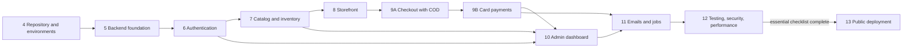

# Implementation Roadmap — Beauty & Cosmetics E-commerce Platform

Oct 8, 2026 · @Fatma

## 1. Summary

Implementation runs in ten phases (4 to 13) grouped into five milestones. The order puts a complete, reliable purchase journey first: a shopper can buy with Cash on Delivery by milestone M3 and by card at M4, before the admin dashboard is built. Until then the catalog comes from seed data.

There are no dates, because there's no deadline. Each phase has a relative size instead: **S** small, **M** medium, **L** large. Every phase ends with its definition of done and the quality gate from the Security & Testing Plan, so nothing moves forward half-finished.

### Milestones

| Milestone | Phases | What you can show at the end | Size |
| --- | --- | --- | --- |
| M1 Walking skeleton | 4, 5 | Three apps running locally and deployed privately; an API endpoint reading from Supabase; CI green | M |
| M2 Accounts and catalog | 6, 7 | Customers and staff can sign in; products, variants and stock exist through the API | L |
| M3 Storefront with COD | 8, first half of 9 | A shopper browses, fills a cart, and places a COD order; stock is correct under concurrency | L |
| M4 Card payments and orders | Second half of 9 | Paymob sandbox payments, webhooks, failures, expiry, cancellations, refunds | L |
| M5 Dashboard and release | 10 to 13 | Bilingual admin dashboard, emails, full test and security review, public demo | L |

### Why this order

- **Riskiest work early.** Authentication, stock concurrency and payments are where mistakes are most expensive, so they come before the dashboard screens.
- **Deploy from the first phase.** A private deployment in phase 4 surfaces hosting surprises (cookies through the proxy, database connections, environment variables) while the code is still tiny.
- **Thin vertical slices.** Each phase delivers working behavior through database, API and screen, rather than building all of one layer before the next.

## 2. Phase dependencies

Phases run mostly in sequence because each builds on the one before; the dashboard (phase 10) waits for the APIs from phases 6, 7 and 9, and going public waits for the full review.

| Milestone | Reached after |
| --- | --- |
| M1 Walking skeleton | Phase 5 |
| M2 Accounts and catalog | Phase 7 |
| M3 Storefront with COD | Phase 9A |
| M4 Card payments | Phase 9B |
| M5 Dashboard and release | Phase 13 |

## 3. How we work during implementation

You write and run the code; I guide each task, explain the reasoning, and review what you build. That way you understand every line, which is the point of a portfolio project.

### For each task

1. **Explain:** I describe the task, the concepts it needs and the approach, with links back to the requirement and test cases.
2. **Build:** you write the code on a branch. For unfamiliar or security-critical parts (sessions, webhook verification, the order transaction) I provide a reference implementation and walk through it line by line.
3. **Test:** you write and run the task's tests, starting with the failure cases.
4. **Review:** you share the branch or the changed files; I review for correctness, security, readability and the definition of done, and explain each comment.
5. **Merge:** after CI passes, merge to `main` and update the progress tracker.

### Definition of done for every task

- [ ] Behavior matches the requirement's acceptance criteria in the PRD
- [ ] Its test cases from the Security & Testing Plan are written and passing, failure cases included
- [ ] Lint, type-check, tests and production build pass in CI
- [ ] No new essential security checklist gaps; no secrets in code or logs
- [ ] Loading, empty and error states handled in any new screen; keyboard accessible; works at 360 px
- [ ] API changes reflected in the shared Zod schemas, so the OpenAPI documentation stays current
- [ ] Decision log updated if a decision changed; known gaps written down, not hidden

### Git workflow

- One short-lived branch per task, named after it, e.g. `feat/order-placement` or `fix/stock-lock-order`.
- Small commits with clear messages in the Conventional Commits style (`feat:`, `fix:`, `test:`, `docs:`, `chore:`).
- `main` is always deployable; branch protection requires CI to pass before merging.
- Database changes always arrive as a migration in the same branch as the code that needs them.

### Progress tracking

A progress table in the repository's `docs/` folder lists each phase's tasks with status, branch and test cases, so decisions and progress stay consistent across sessions.

## 4. Phases 4 to 7: foundation, accounts and catalog

### Phase 4: Repository and environments · M · milestone M1

**Goal:** an empty but complete monorepo that runs locally, passes CI and deploys privately, so every later phase only adds features.

**Depends on:** approved architecture, database design and API contracts.

**Tasks**

1. Create the GitHub repository with npm workspaces and Turborepo (D-089, D-143); add `apps/storefront`, `apps/dashboard`, `apps/api` (latest stable Next.js, TypeScript strict) and `packages/shared`, plus Prettier at the root (D-099; shared ESLint config in phase 5, D-144).
2. Set up Tailwind with logical classes in both frontends; add next-intl to the dashboard with `lang` and `dir` switching and empty English and Arabic message files (D-091, D-092).
3. Move in the verified Prisma schema, `prisma.config.ts`, the constraints migration and the database test script; run them against the Supabase CLI local stack.
4. Add Mailpit for local email, `.env.example` files for each app, and a README that gets a new developer running in under 30 minutes (NFR-28).
5. Configure the frontends' `/api/*` rewrites to the API app (D-072) and a `GET /api/v1/health` endpoint.
6. GitHub Actions CI: install, lint, type-check, tests against a PostgreSQL service, migrations from an empty database, Row Level Security check, production build of all apps (D-098).
7. Create the Supabase demo project (European region, lockdown applied) and three Vercel projects with deployment protection turned on, so only you can open them until phase 13; align the API's function region with the database.

**Deliverables:** running monorepo, green CI, private deployments, README.

**Acceptance and tests:** `npm run dev` starts all three apps; the health check answers through both frontends' proxies, locally and deployed; the database test script passes on Supabase's PostgreSQL; T-SY-05.

**Done when:** a fresh clone reaches a running setup by following the README alone, and `main` deploys automatically.

### Phase 5: Backend foundation · M · milestone M1

**Goal:** the shared machinery every endpoint uses, built and tested once.

**Depends on:** phase 4.

**Tasks**

1. A route-handler wrapper: request ID, Origin check per route group, JSON-only mutations, session resolution hook, permission hook, Zod validation, error mapping to the shared format (D-121 to D-123).
2. Typed service errors (`OutOfStockError`, `StaleVersionError` and so on) and the error code catalog in `packages/shared`.
3. Prisma client using the pooled connection through the PostgreSQL driver adapter; a transaction helper.
4. Pino logging with redaction (D-096), Sentry in all three apps with scrubbing (D-087), environment validation at startup.
5. Database-backed rate limiter, idempotency-key helper, pagination helper, injectable clock.
6. Adapter interfaces with in-memory fakes: `PaymentProvider`, `EmailSender`, `FileStorage`, `ErrorReporter`; the email outbox writer with a local sender to Mailpit.
7. OpenAPI generation from the shared schemas.
8. Test harness: test database setup, data factories, HTTP helpers.
9. First real endpoints: `GET /store/checkout/config` and the governorates and settings seed.

**Acceptance and tests:** T-SY-03, T-SY-04, T-SY-06, T-AU-11 (Origin and JSON checks), T-NF-06 (headers), BE-16 seed run twice.

**Done when:** a new endpoint can be added by writing only a schema, a service function and a short route file.

### Phase 6: Authentication and authorization · L · milestone M2

**Goal:** customers and staff can sign in securely, and every admin endpoint is protected by a named permission.

**Depends on:** phase 5.

**Tasks**

1. Customer registration, sign-in, sign-out and session endpoints; Argon2id hashing; common-password check; `__Host-customer_session` cookie (D-073 to D-075, D-125).
2. Email verification, password reset and email change with single-use hashed tokens, emails through the outbox.
3. Staff sign-in with lockout, idle and absolute timeouts, invite acceptance, and the setup script for the first Admin (D-042).
4. Permission map and `requirePermission`; the generated authorization test suite that fails if any admin route lacks a permission (D-126, T-AZ-01).
5. Account endpoints: profile, addresses, account deletion (completed in phase 9 once orders exist).
6. Sign-in and registration pages in the storefront; sign-in page in the dashboard in English and Arabic.

**Acceptance and tests:** T-AU-01 to T-AU-08, T-AU-10, T-AU-11, T-AZ-01 (framework), T-AZ-04, T-AC-01.

**Done when:** the essential checklist's authentication section is fully ticked.

### Phase 7: Catalog and inventory · L · milestone M2

**Goal:** products with options, variants, images and stock exist and can be managed and browsed through the API.

**Depends on:** phase 6 (admin endpoints need permissions).

**Tasks**

1. Admin endpoints for brands, categories, products, options, variants, images and status changes, with activation rules and version checks.
2. Image upload: content sniffing, sharp re-encoding to fixed WebP sizes, Supabase Storage through `FileStorage` (D-086, D-095).
3. Inventory: stock adjustments with reasons and `expectedStock`, stock movements, low-stock list (AD-04).
4. Storefront endpoints: home, product listing with filters, sorting, page clamping and trigram search, product page, categories, brands.
5. Content endpoints: banners and featured products.
6. Demo catalog seed: brands, two-level categories, products with shades, sizes and scents, images within the storage budget.

**Acceptance and tests:** T-CA-01 to T-CA-07, T-IN-01, T-IN-02, T-AD-08 (API).

**Done when:** the full demo catalog is loaded by the seed and browsable through the API.

## 5. Phases 8 to 10: storefront, checkout and dashboard

### Phase 8: Storefront · L · milestone M3

**Goal:** a shopper can browse, search, choose variants, fill a cart and manage their account on a fast, accessible, mobile-first site.

**Depends on:** phase 7.

**Tasks**

1. Layout, header with search and cart count, mobile navigation, footer, design tokens and shadcn/ui components (D-091).
2. Homepage; category, brand and search listing pages with filters, sorting and pagination stored in the URL (D-054).
3. Product page: gallery, option selectors with shade swatches, variant price and stock state, "From" prices, 404 and 410 handling.
4. Cart: browser cart for guests priced through `/cart/price`, server cart for customers, merge on sign-in, notices for changed prices and unavailable items.
5. Account pages: profile, addresses, password; order history comes in phase 9.
6. Content pages; SEO metadata, canonical URLs, sitemap, robots and noindex for the demo (NFR-23 to NFR-25).
7. Accessibility and responsive baseline checked on every page (360 px to 1920 px, keyboard, axe).

**Acceptance and tests:** T-SF-01 to T-SF-03, T-CT-01, T-CT-02, T-CA-06 (end to end), T-NF-03 and T-NF-05 on finished pages.

**Done when:** every catalog and cart screen works on a phone and by keyboard, with loading, empty and error states.

### Phase 9: Checkout, orders and payments · L · milestones M3 and M4

**Goal:** the complete purchase journey: COD first, then card payments with every failure path handled.

**Depends on:** phase 8.

**Part A, Cash on Delivery (M3)**

1. Checkout configuration and quote endpoints; single-page checkout with saved addresses and governorate-based fees.
2. The order placement transaction exactly as designed: idempotency key, expired-order release, row locks in variant order, server prices, `expectedTotal` check, snapshots, stock movements, outbox email (database design section 5.1).
3. Guest order tokens; order confirmation, order history and guest tracking pages.
4. Order state machine with compare-and-set updates; customer cancellation; account deletion completed (anonymization).

**Part B, card payments (M4)**

1. **Paymob spike, one day, first:** test account, one hosted-checkout payment, one verified webhook (D-078). Switch to Kashier if blocked.
2. Paymob adapter implementing `PaymentProvider`; webhook endpoint with raw-body signature check and event de-duplication.
3. Card flow: redirect, return page polling with server-side reconciliation, retry payment, switch to COD.
4. Expiry with the provider status check before cancelling; late-payment rule; daily job hook.
5. Refund service: provider refunds with idempotency keys and webhook confirmation; manual COD refunds.
6. Sandbox run of the card journeys on the private deployment.

**Acceptance and tests:** T-CO-01 to T-CO-10, T-PA-01 to T-PA-07, T-OL-01, T-OL-02, T-AZ-02, T-AZ-03, T-AC-02, T-AC-03, T-RF-01, T-RF-02.

**Done when:** SM-1, SM-3 and SM-4 pass, and the money-and-stock section of the essential checklist is fully ticked.

### Phase 10: Admin dashboard · L · milestone M5

**Goal:** the store team runs catalog, stock and fulfilment from a bilingual dashboard, with Admin-only tools for money, staff and settings.

**Depends on:** phases 6, 7 and 9 (all admin APIs that exist so far).

**Tasks, in this order**

1. App shell: sign-in, navigation by permission, counters, language switch with full RTL, 2FA screens if built (AD-15, AD-16).
2. **Orders first**, because fulfilment matters most: list with filters, detail, transitions, address edit, cancel, COD collected, returned to sender.
3. Refunds and returns screens, plus the returns endpoint.
4. Products: list, editor for options and variants, image upload with browser-side resize; brands and categories.
5. Inventory: adjustments, stock history, low-stock view.
6. Customers, shipping, homepage content, settings.
7. Staff management, analytics (including "New customers", Could Have), CSV exports, audit log viewer.

**Acceptance and tests:** T-OL-03 to T-OL-06, T-RF-03, T-AD-01 to T-AD-08, T-AZ-01 complete for every route, T-AU-09 if 2FA is built.

**Done when:** every dashboard screen works in English and Arabic, and a Staff member can't reach any Admin-only screen or endpoint.

## 6. Phases 11 to 13: emails, review and release

### Phase 11: Emails and background jobs · M · milestone M5

**Goal:** every transactional email is sent reliably, and the daily job keeps the database tidy.

**Depends on:** phases 9 and 10 (the events that trigger emails).

**Tasks**

1. Email templates for all customer and staff emails (D-048, D-049): plain, accessible HTML with a text version, English only.
2. Resend adapter for `EmailSender` (D-085); outbox sending right after commit; retries with backoff.
3. Daily job endpoint protected by `CRON_SECRET`, scheduled with Vercel Cron: full expiry sweep, email retries, deletion of expired sessions, tokens, idempotency keys and old webhook events and sent emails (D-120), low-stock summary, new-order notification setting.

**Acceptance and tests:** T-SY-01, T-SY-02, T-PA-06 (sweep path).

**Done when:** with the email service switched off, orders still succeed, and the emails go out once it's back.

### Phase 12: Testing, security review and performance · M · milestone M5

**Goal:** prove the whole system meets the PRD, not just its parts.

**Depends on:** phases 4 to 11.

**Tasks**

1. Fill any gaps in the traceability matrix; full end-to-end suite on Chromium, WebKit and Firefox.
2. Accessibility: automated axe checks on all key pages, plus the manual keyboard and screen-reader checklist.
3. Performance: Lighthouse CI on mobile and k6 load tests at 50 concurrent users against a production build; fix anything over target (NFR-01 to NFR-03).
4. Security review: walk the whole essential checklist, verify every threat's proving test, fix findings, record accepted gaps.
5. Should Haves if time allows, each with its own tests: 2FA (AD-16), Google sign-in (ST-08), wallets (ST-19); then Could Haves such as the wishlist.

**Acceptance and tests:** all 80 test cases; T-NF-01 to T-NF-07.

**Done when:** the Release 1.0 gate passes locally, with no open essential checklist items.

### Phase 13: Deployment and production verification · S · milestone M5

**Goal:** a public demo that is safe, documented and verified on the real infrastructure.

**Depends on:** phase 12 (the essential checklist must be complete before going public, D-133).

**Tasks**

1. Final production configuration: environment variables, Paymob webhook URL, Resend, Sentry, cron schedule, noindex.
2. Migrations and demo seed on the demo database; create the first Admin with the setup script.
3. Run the Release 1.0 gate on the deployed demo, including the Paymob sandbox journeys.
4. Backup and restore exercise into a fresh database (SM-7, T-NF-08).
5. Turn off deployment protection, making the demo public.
6. Documentation: README, architecture notes, published OpenAPI, runbook (backups, restore, rotating secrets), release notes with known gaps, and a client adaptation guide based on the architecture's section 10.

**Done when:** the demo is public, every gate has passed on it, and someone else could set up a client store from the documentation.

## 7. Risks and decisions

### Risks

| Risk | Likelihood | Effect | Response |
| --- | --- | --- | --- |
| Paymob test account is slow or blocked | Medium | Card payments delayed | One-day spike at the start of phase 9 Part B; switch to Kashier through the adapter (D-078); COD works regardless |
| Next.js and Prisma major versions change APIs | Medium | Tutorials and memory don't match the installed version | Check the installed version's docs first; pin exact versions; Prisma's driver-adapter setup proven in phase 4 |
| Authentication or concurrency mistakes | Medium | Security or stock bugs | Reference implementations, failure-first tests, the concurrency suite, review before merge |
| Scope creep | High | Unfinished features everywhere | MoSCoW priorities; Should and Could items only in phase 12 after all Musts pass |
| Free-tier limits or pausing | Low | Demo offline | Daily cron, storage budget, limits documented in the architecture's section 8 |
| Losing momentum without a deadline | Medium | Project stalls | Milestones that each produce something demonstrable; progress tracker |
| Arabic RTL issues found late | Medium | Rework of dashboard screens | RTL switch and logical classes from phase 4; every dashboard task checked in Arabic |

### Decisions (approved 8 October 2026)

| ID | Decision |
| --- | --- |
| D-138 | Phase order and milestones M1 to M5, with COD before card payments and the dashboard after the purchase journey |
| D-139 | Way of working: you write and run the code; I explain each task, provide reference implementations for security-critical parts, and review before merge |
| D-140 | Private deployments from phase 4 behind deployment protection; public only in phase 13 after the essential checklist |
| D-141 | Git workflow and the definition of done for every task (section 3) |
| D-142 | Progress tracker in the repository's `docs/` folder |

- [x] D-138 to D-142 approved
- [x] Roadmap approved; next is phase 4, task 1
